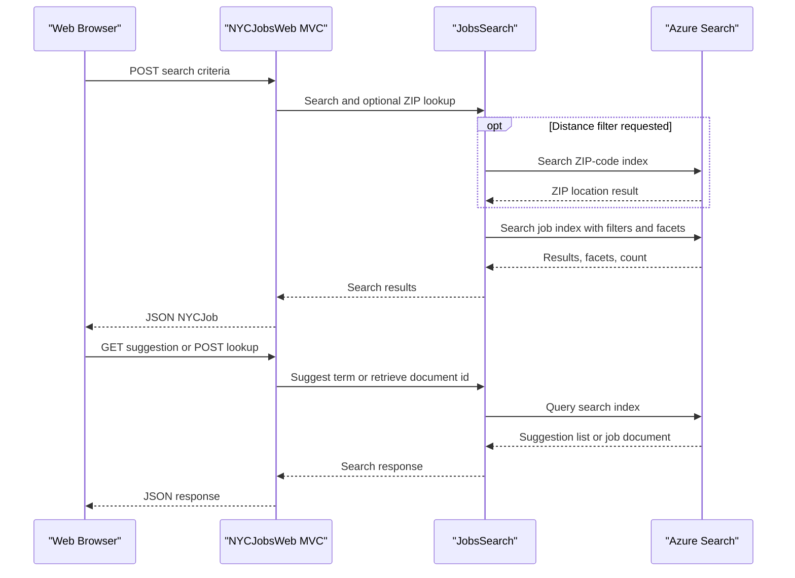

# API & Service Communication Contracts

The website exposes MVC page and JSON actions through conventional routing. The browser communicates synchronously with the website, which calls Azure Search; the separate console loader uses the Azure Search REST API for index administration.

## Service Catalog

| Service | Port | Category | Purpose |
|---|---|---|---|
| NYCJobsWeb | Not specified | API Layer | Serves job-search pages and JSON actions |
| AzureSearchBackupRestore | None; console process | Infrastructure | Creates and populates Azure Search indexes from local sample data |
| Azure Cognitive Search | Configured externally | Infrastructure | Stores and searches job and ZIP-code index documents |

## API Endpoints Inventory

| Service | Method | Path | Request Type | Response Type |
|---|---|---|---|---|
| NYCJobsWeb | MVC default | `/Home/Index` | None | HTML view |
| NYCJobsWeb | MVC default | `/Home/JobDetails` | None | HTML view |
| NYCJobsWeb | POST from browser | `/Home/Search` | Query, facets, sorting, page, and location values | JSON `NYCJob` |
| NYCJobsWeb | GET | `/Home/Suggest?term=...` | Query parameter `term`, optional `fuzzy` | JSON array of suggestion strings |
| NYCJobsWeb | POST from browser | `/Home/LookUp` | Form parameter `id` | JSON `NYCJobLookup` |

`HomeController.Search` and `HomeController.LookUp` do not constrain the HTTP verb with attributes; the listed verbs reflect the current browser calls. API versioning is not implemented for the MVC actions.

## Management & Observability Endpoints

| Service | Endpoint | Custom Metrics |
|---|---|---|
| NYCJobsWeb | None found | None found |
| AzureSearchBackupRestore | Console process; no HTTP endpoint | None found |

## DTOs & Contracts

`NYCJob` is the search response wrapper containing result documents, facets, and a count. `NYCJobLookup` wraps one Azure Search `SearchDocument` for the detail view. These are mutable C# classes; no explicit OpenAPI document, protobuf, GraphQL schema, or custom API serializer configuration was found. Azure Search SDK model types supply the indexed document contract.

## Communication Patterns

- Browser-to-website requests use synchronous HTTP form posts for search and lookup, and an HTTP GET for suggestions.
- `JobsSearch` uses the Azure Search .NET client synchronously for search, suggestion, document lookup, and ZIP-code search.
- The loader sends synchronous REST requests to Azure Search with `HttpClient`; JSON payloads are used to create indexes and upload documents.
- No message queue, retry policy, circuit breaker, service discovery, API gateway, or client-side load balancing was found.
- Azure Search calls use an API key. No application-level authentication or authorization is configured for the MVC actions, and the repository does not show HTTPS enforcement for the website.

## Service Technology Matrix

| Service | Web | Data Access | Discovery | Gateway | Actuator | Cache | Metrics |
|---|---|---|---|---|---|---|---|
| NYCJobsWeb | ASP.NET MVC 5 | Azure Search SDK | None | None | None | None | None |
| AzureSearchBackupRestore | Console | Azure Search REST API | None | None | None | None | None |
| Azure Cognitive Search | Managed service | Search indexes | N/A | N/A | Managed externally | Not configured by application | Managed externally |

## Service Communication Sequence

