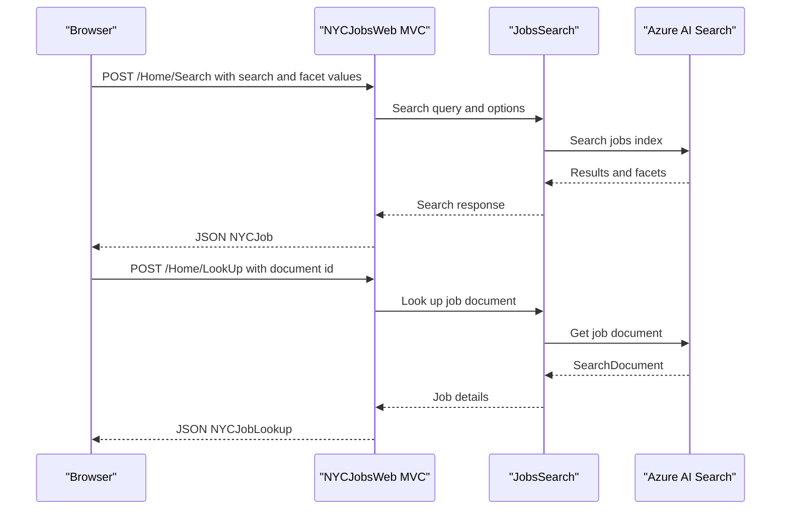

# API & Service Communication Contracts

The web application exposes MVC page actions and JSON-returning job search actions. Browser requests are synchronous request/response calls; the application also makes synchronous queries to Azure AI Search.

## Service Catalog

| Service | Port | Category | Purpose |
|---|---|---|---|
| NYCJobsWeb | Not specified | API Layer | Serves job-search pages and JSON search/detail responses |
| DataLoader | Not applicable | Infrastructure utility | Populates Azure Search indexes from local sample files |

## API Endpoints Inventory

| Service | Method | Path | Request Type | Response Type |
|---|---|---|---|---|
| NYCJobsWeb | GET | `/Home/Index` | None | Search page |
| NYCJobsWeb | GET | `/Home/JobDetails?id={id}` | Query parameter `id` | Job detail page |
| NYCJobsWeb | POST | `/Home/Search` | Form/query values for search text, facets, location, sorting, and paging | JSON `NYCJob` |
| NYCJobsWeb | GET | `/Home/Suggest?term={term}&fuzzy={fuzzy}` | Query parameters | JSON list of suggestion strings |
| NYCJobsWeb | POST | `/Home/LookUp` | Form parameter `id` | JSON `NYCJobLookup` |

The routes use the conventional MVC route `{controller}/{action}/{id}`. `Search` and `LookUp` do not declare verb attributes; the methods above reflect their observed browser callers.

## Management & Observability Endpoints

| Service | Endpoint | Custom Metrics |
|---|---|---|
| NYCJobsWeb | None identified | None identified |
| DataLoader | None; command-line utility | None identified |

## DTOs & Contracts

`NYCJob` is the mutable JSON response envelope for search results, facets, and count. `NYCJobLookup` wraps a single Azure Search `SearchDocument` for job details. The application uses Azure Search SDK models for individual records; no dedicated immutable request/response records, OpenAPI specification, protobuf schema, or GraphQL schema was found. JSON serialization is provided by ASP.NET MVC and the Azure SDK.

## Communication Patterns

- The browser posts search input to the MVC application and receives JSON results; it requests suggestions and job details through the MVC actions.
- `JobsSearch` calls Azure AI Search synchronously for search, suggestions, postal-code lookup, and document lookup.
- DataLoader uses synchronous `HttpClient` calls to the Azure Search REST API to create indexes and upload documents from local files.
- No message broker, asynchronous event flow, service discovery, API gateway, retry policy, circuit breaker, or explicit timeout policy was identified.
- No application-level authentication, authorization, or HTTPS enforcement is configured. DataLoader targets Azure Search over HTTPS; the web application's hosting transport is not specified.

## Service Technology Matrix

| Service | Web | Data Access | Discovery | Gateway | Health | Cache | Metrics |
|---|---|---|---|---|---|---|---|
| NYCJobsWeb | ASP.NET MVC 5 | Azure Search SDK | None | None | None | None | None |
| DataLoader | Console application | Azure Search REST API | None | None | Not applicable | None | None |

## Service Communication Sequence

