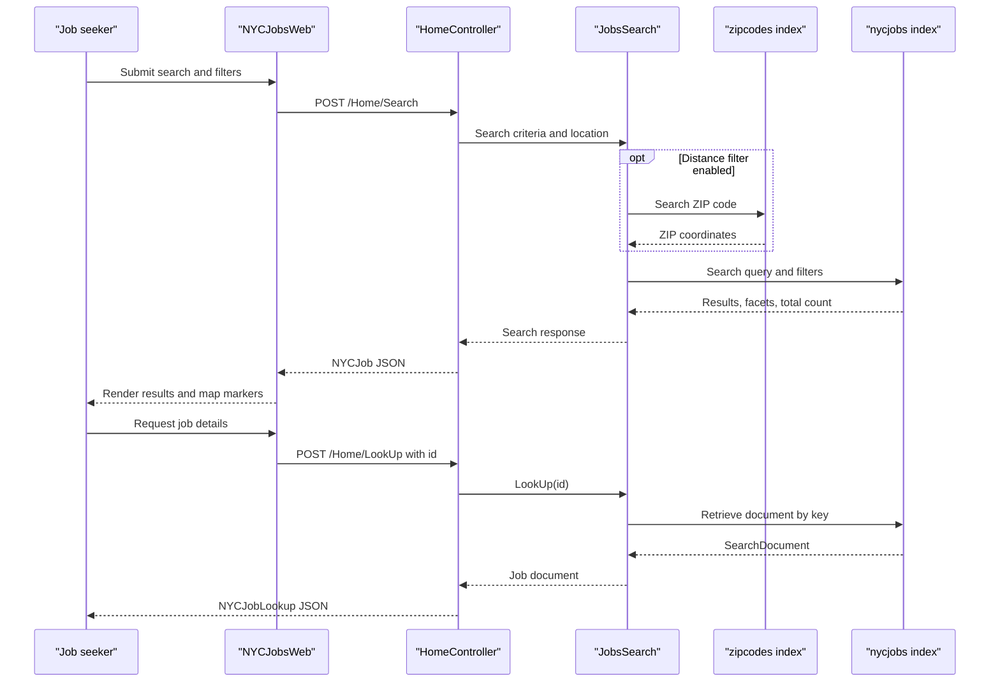

# API & Service Communication Contracts

The web application exposes five MVC actions for its user-facing job search, suggestions, and job detail flow. Requests are handled synchronously; the application calls Azure Cognitive Search directly and has no discovered service gateway or message broker.

## Service Catalog

| Service | Port | Category | Purpose |
|---|---|---|---|
| NYCJobsWeb | Not specified; hosted by IIS/IIS Express | API Layer | Serves search pages and JSON responses |
| AzureSearchBackupRestore | Not applicable; console process | Infrastructure utility | Rebuilds and imports the job and ZIP code search indexes |
| Azure Cognitive Search | Hosted endpoint; configured externally | Infrastructure | Provides the `nycjobs` and `zipcodes` indexes |
| Bing Maps | External browser API | Infrastructure | Renders the map and job-location markers |

## API Endpoints Inventory

The default MVC route is `/{controller}/{action}/{id}`. No API versioning scheme or explicit route attributes were found.

| Service | Method | Path | Request Type | Response Type |
|---|---|---|---|---|
| NYCJobsWeb | GET | `/Home/Index` | None | HTML view |
| NYCJobsWeb | GET | `/Home/JobDetails` | None | HTML view |
| NYCJobsWeb | POST (UI); action has no verb restriction | `/Home/Search` | Search text, facets, sort, location, page, and distance parameters | `NYCJob` JSON: search results, facets, count |
| NYCJobsWeb | GET | `/Home/Suggest` | `term` query parameter and optional `fuzzy` flag | JSON array of suggestion strings |
| NYCJobsWeb | POST (UI); action has no verb restriction | `/Home/LookUp` | Job `id` parameter | `NYCJobLookup` JSON containing a search document |

## Management & Observability Endpoints

| Service | Endpoint | Custom Metrics |
|---|---|---|
| NYCJobsWeb | None detected | None detected |

No health-check, Swagger/OpenAPI, or metrics endpoints were identified.

## DTOs & Contracts

`NYCJob` is a mutable response wrapper for search results, facets, and count. `NYCJobLookup` is a mutable response wrapper for one Azure Search `SearchDocument`. Search inputs are MVC action parameters rather than dedicated request DTOs. The application uses MVC `JsonResult` serialization; the loader also contains a Newtonsoft.Json helper. No OpenAPI, protobuf, or GraphQL contract files were found.

## Communication Patterns

The browser calls MVC actions over HTTP. The controller delegates to `JobsSearch`, which uses synchronous Azure Search SDK calls for queries, suggestions, and document lookup. When distance filtering is enabled, it first queries the ZIP index to obtain a location and then runs the job search. The separate console utility makes synchronous REST requests to create/delete indexes and upload documents.

No asynchronous messaging, service discovery, API gateway, client-side load balancing, retry policy, or circuit breaker was found. Search exceptions are caught in `JobsSearch` and generally result in a null response; there is no defined downstream fallback. No authentication or authorization checks were identified in the MVC actions. TLS settings are not established by application code; the Azure Search endpoint uses HTTPS, while deployment-side browser/API transport configuration is not specified.

## Service Technology Matrix

| Service | Web | Data Access | Discovery | Gateway | Health | Cache | Metrics |
|---|---|---|---|---|---|---|---|
| NYCJobsWeb | ASP.NET MVC 5 | Azure Search SDK | None | None | None found | None found | None found |
| AzureSearchBackupRestore | Console | Azure Search REST API | None | None | Not applicable | None found | None found |

## Service Communication Sequence

