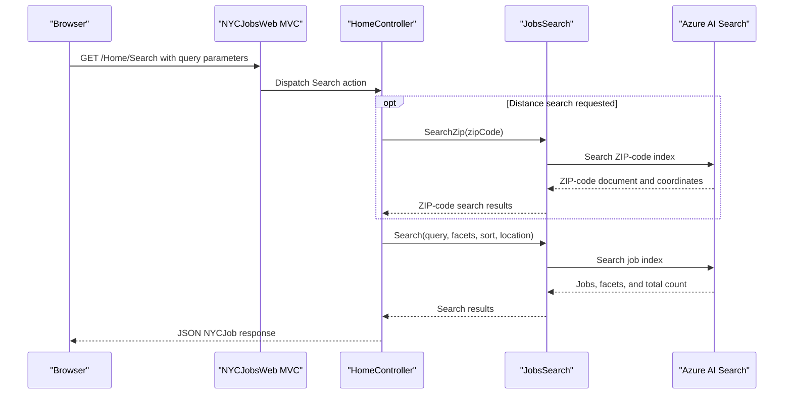

# API & Service Communication Contracts

The web application exposes MVC page routes and three JSON actions. It calls Azure AI Search synchronously for job search, ZIP-code lookup, suggestions, and document retrieval; the separate importer synchronously manages index contents.

## Service Catalog

| Service | Port | Category | Purpose |
|---|---|---|---|
| NYCJobsWeb | Not configured | API Layer | Serves job-search pages and JSON search operations |
| AzureSearchBackupRestore | Not applicable | Business | Console utility that recreates search indexes and uploads local data |
| Azure AI Search | Service-managed | Infrastructure | Provides job and ZIP-code search indexes |

## API Endpoints Inventory

| Service | Method | Path | Request Type | Response Type |
|---|---|---|---|---|
| NYCJobsWeb | GET | `/Home/Index` | Route parameters, none required | Razor view |
| NYCJobsWeb | GET | `/Home/JobDetails` | Route parameters, none required | Razor view |
| NYCJobsWeb | GET | `/Home/Search` | Query parameters: `q`, facets, sort, location, page, and distance | JSON `NYCJob` |
| NYCJobsWeb | GET | `/Home/Suggest` | Query parameters: `term`, optional `fuzzy` | JSON list of suggestion strings |
| NYCJobsWeb | GET | `/Home/LookUp/{id}` | Route parameter: `id` | JSON `NYCJobLookup` |
| Azure AI Search | HTTPS REST | `/{index}/docs/search`, `/{index}/docs/suggest`, `/{index}/docs/{key}` | Azure Search query, suggestion, or key | Azure Search response |
| Azure AI Search | HTTPS REST | `/indexes`, `/indexes/{index}`, `/{index}/docs/index` | Index schema or document action JSON | HTTP response |

The web paths follow the default MVC route `/{controller}/{action}/{id}`; deployment-level path prefixes are not specified in the repository.

## Management & Observability Endpoints

| Service | Endpoint | Custom Metrics |
|---|---|---|
| NYCJobsWeb | None identified | None identified |
| AzureSearchBackupRestore | None; console process | None identified |

## DTOs & Contracts

`NYCJob` and `NYCJobLookup` are response models returned by the search and lookup actions. They are mutable C# classes; no dedicated request-body DTOs or immutable contract types were identified. Search inputs are supplied as query and route parameters. The importer transmits index schemas and document payloads as JSON files. No OpenAPI/Swagger, GraphQL, or protobuf contract files were found.

## Communication Patterns

The browser calls MVC actions over HTTP. `HomeController` makes synchronous direct calls through `JobsSearch` to Azure AI Search for queries and document lookup; no message broker, service discovery, gateway aggregation, retry policy, circuit breaker, or explicit timeout policy was identified. The importer uses synchronous `HttpClient` calls via `AzureSearchHelper` to the Azure Search REST API.

The application configuration does not show API authentication, authorization, or an application-level TLS enforcement policy. The search service integration is configured to use the HTTPS Azure Search endpoint; client-to-application transport security depends on deployment configuration not present here.

## Service Technology Matrix

| Service | Web | Data Access | Discovery | Gateway | Health | Cache | Metrics |
|---|---|---|---|---|---|---|---|
| NYCJobsWeb | ASP.NET MVC 5 | Azure AI Search SDK | None | None | None identified | None identified | None identified |
| AzureSearchBackupRestore | Console application | Azure Search REST API | Configured service name | None | None | None | None |
| Azure AI Search | Managed service | Search indexes | Azure-managed | None | Service-managed | Service-managed | Service-managed |

## Service Communication Sequence

