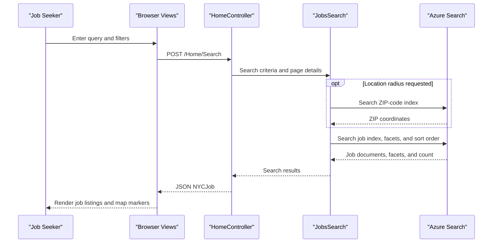

# API & Service Communication Contracts

The web application exposes two HTML view actions and three JSON-oriented job search actions using ASP.NET MVC's conventional routes. Requests are synchronous and query Azure Cognitive Search; the separate DataLoader utility uses synchronous HTTP calls to provision indexes.

## Service Catalog

| Service | Port | Category | Purpose |
|---|---|---|---|
| NYCJobsWeb | Not configured in repository | API Layer | Serves job-search pages and JSON search/suggestion/lookup responses |
| DataLoader | Not applicable | Infrastructure | Recreates Azure Search indexes and imports local schema/data files |

## API Endpoints Inventory

| Service | Method | Path | Request Type | Response Type |
|---|---|---|---|---|
| NYCJobsWeb | GET | `/Home/Index` | None | HTML view |
| NYCJobsWeb | GET | `/Home/JobDetails` | None | HTML view |
| NYCJobsWeb | POST (used by browser) | `/Home/Search` | Query/form values: `q`, facets, sorting, coordinates, page, ZIP, distance | JSON `NYCJob` containing search results, facets, and count |
| NYCJobsWeb | GET | `/Home/Suggest` | Query values: `term`, optional `fuzzy` | JSON string list |
| NYCJobsWeb | POST (used by browser) | `/Home/LookUp` | Form value: `id` | JSON `NYCJobLookup` containing one search document |

All routes use the default `{controller}/{action}/{id}` route. No API versioning scheme is configured. The Search and LookUp actions have no HTTP-method attribute, so the table records the browser's observed POST usage; their actual accepted verbs are not restricted by those action declarations.

## Management & Observability Endpoints

| Service | Endpoint | Custom Metrics (if any) |
|---|---|---|
| NYCJobsWeb | None found | None found |
| DataLoader | None; command-line executable | None found |

No health-check, Swagger/OpenAPI, actuator, or metrics endpoint was identified.

## DTOs & Contracts

`NYCJob` is the search response wrapper containing Azure Search results, facets, and a result count. `NYCJobLookup` wraps a single `SearchDocument` for job details. These are mutable C# classes; no separate request DTOs are defined because MVC binds action parameters directly. Azure Search SDK models are used for result documents. JSON is emitted by ASP.NET MVC's `JsonResult`; the DataLoader helper uses Newtonsoft.Json for JSON serialization. No OpenAPI, protobuf, or GraphQL contract was found.

## Communication Patterns

The browser communicates with the MVC application through conventional HTTP routes and AJAX requests. The controller calls the `JobsSearch` class directly, which uses Azure Search SDK clients to query the `nycjobs` and `zipcodes` indexes. The DataLoader communicates with the Azure Search REST API over HTTPS using `HttpClient`; the API version is appended by `AzureSearchHelper`.

No message broker, service discovery, gateway, client-side load balancing, retry policy, circuit breaker, or timeout policy is configured. Search access is synchronous from the controller. The DataLoader wraps request failures in local exception handling but does not implement retries. No API authentication or authorization checks are present in the controller or route configuration. The application host's incoming TLS configuration is not specified in the repository; outgoing Azure Search REST requests use HTTPS.

## Service Technology Matrix

| Service | Web | Data Access | Discovery | Gateway | Actuator | Cache | Metrics |
|---|---|---|---|---|---|---|---|
| NYCJobsWeb | ASP.NET MVC 5 | Azure Search SDK | None | None | None | None | None |
| DataLoader | Console application | Azure Search REST API | None | None | None | None | None |

## Service Communication Sequence

