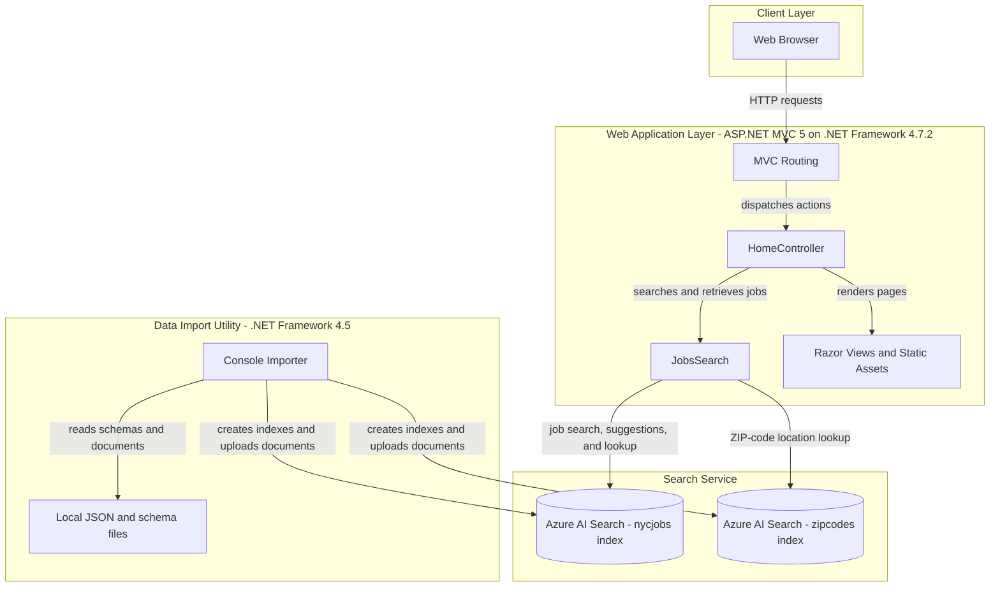
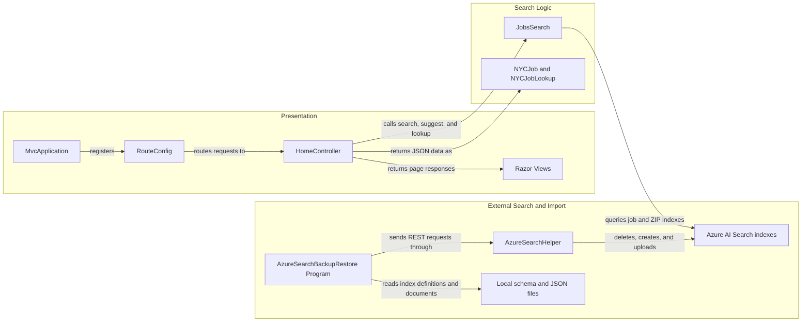

# Architecture Diagram

This repository contains an ASP.NET MVC job-search website and a separate console utility for importing job and ZIP-code data into Azure AI Search.

## Application Architecture

### Technology Stack Summary

| Layer | Technology | Version | Purpose |
|---|---|---|---|
| Presentation | ASP.NET MVC | 5.2.2 | Server-rendered web pages and JSON actions |
| Application | .NET Framework | 4.7.2 | Hosts the job-search web application |
| Search integration | Azure.Search.Documents | 11.1.1 | Queries Azure AI Search job and ZIP-code indexes |
| Data import | .NET Framework console application | 4.5 | Recreates indexes and uploads local sample data |
| Import transport | HttpClient and Azure Search REST API | API version 2015-02-28-Preview | Index and document management |
| Serialization | Newtonsoft.Json | 10.0.3 (web), 9.0.1 (importer) | JSON serialization support |

### Data Storage & External Services

The web application reads job records, facets, suggestions, and ZIP-code coordinates from two Azure AI Search indexes named `nycjobs` and `zipcodes`. The importer loads index schemas and document JSON from local files and sends create, delete, and upload requests to the configured Azure AI Search service. No relational database or cache is configured in the inspected application files.

### Key Architectural Decisions

- The job-search website uses ASP.NET MVC controllers and a dedicated `JobsSearch` class to mediate access to Azure AI Search.
- Search and location lookup are backed by separate job and ZIP-code indexes.
- A standalone console application provides an offline-style bulk index recreation and data upload path using local schema and JSON files.

## Component Relationships

### Component Inventory

| Component | Layer | Type | Responsibility |
|---|---|---|---|
| MvcApplication | Presentation | ASP.NET application startup | Registers application areas and MVC routes |
| RouteConfig | Presentation | MVC routing configuration | Maps incoming URLs to controller actions |
| HomeController | Presentation | MVC controller | Serves pages and exposes job search, suggestion, and lookup actions |
| JobsSearch | Search Logic | Search client wrapper | Builds Azure AI Search queries for job and ZIP-code indexes |
| NYCJob and NYCJobLookup | Search Logic | Response models | Shape search results and document lookup responses |
| AzureSearchBackupRestore Program | Infrastructure | Console importer | Recreates indexes and uploads local data |
| AzureSearchHelper | Infrastructure | HTTP and JSON helper | Adds the Search API version and sends REST requests |
