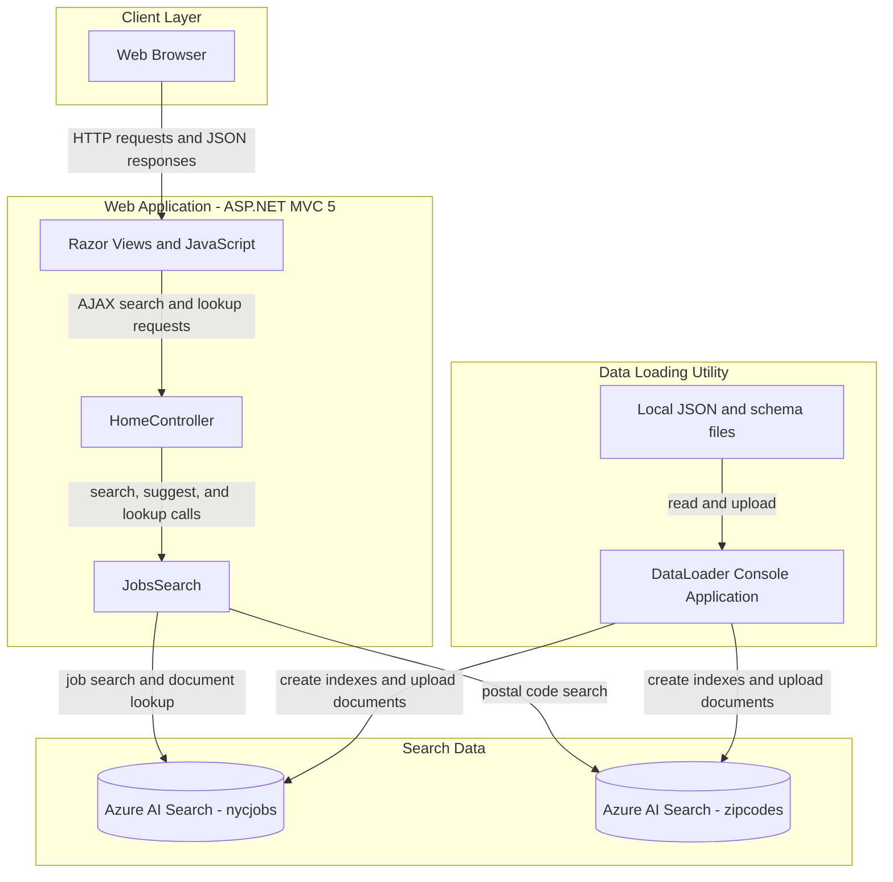
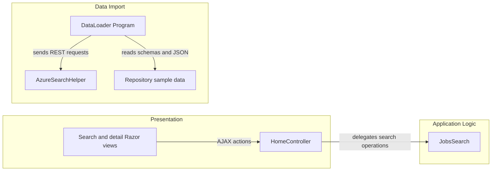

# Architecture Diagram

The repository contains a public job-search web application and a separate console utility for loading sample data. Both use Azure AI Search indexes as their shared data boundary.

## Application Architecture

### Technology Stack Summary

| Layer | Technology | Version | Purpose |
|---|---|---:|---|
| Web presentation | ASP.NET MVC / Razor | MVC 5.2.2 | Renders job search and detail pages |
| Web runtime | .NET Framework | 4.7.2 | Hosts the MVC application |
| Search access | Azure.Search.Documents | 11.1.1 | Queries Azure AI Search |
| Data loading | .NET Framework console application | 4.5 | Creates and populates search indexes |
| Browser interface | JavaScript, jQuery, Bootstrap | jQuery 3.1.1; Bootstrap 3.4.1 | Search interaction and page presentation |

### Data Storage & External Services

Azure AI Search stores job postings and postal-code location records in the `nycjobs` and `zipcodes` indexes. The web application reads those indexes, while DataLoader reads repository JSON/schema files and sends index-management and document-upload requests. No relational database, message broker, or cache is configured.

### Key Architectural Decisions

- The web application and data loader are separate projects that share Azure Search indexes rather than a relational database.
- Job search, suggestions, and document lookup are handled by one MVC controller and a dedicated search wrapper.
- Sample records and index schemas are repository files used by the standalone loader.

## Component Relationships

### Component Inventory

| Component | Layer | Type | Responsibility |
|---|---|---|---|
| Search and detail Razor views | Presentation | MVC views | Accept search input and render results and job details |
| HomeController | Presentation | MVC controller | Exposes search, suggestion, detail, and page actions |
| JobsSearch | Application Logic | Search client wrapper | Builds Azure Search queries and retrieves documents |
| DataLoader Program | Data Import | Console entry point | Deletes/recreates indexes and uploads sample records |
| AzureSearchHelper | Data Import | HTTP helper | Sends REST requests and serializes JSON payloads |
| Repository sample data | Data Import | JSON/schema files | Provides index schemas and sample job/postal-code records |
