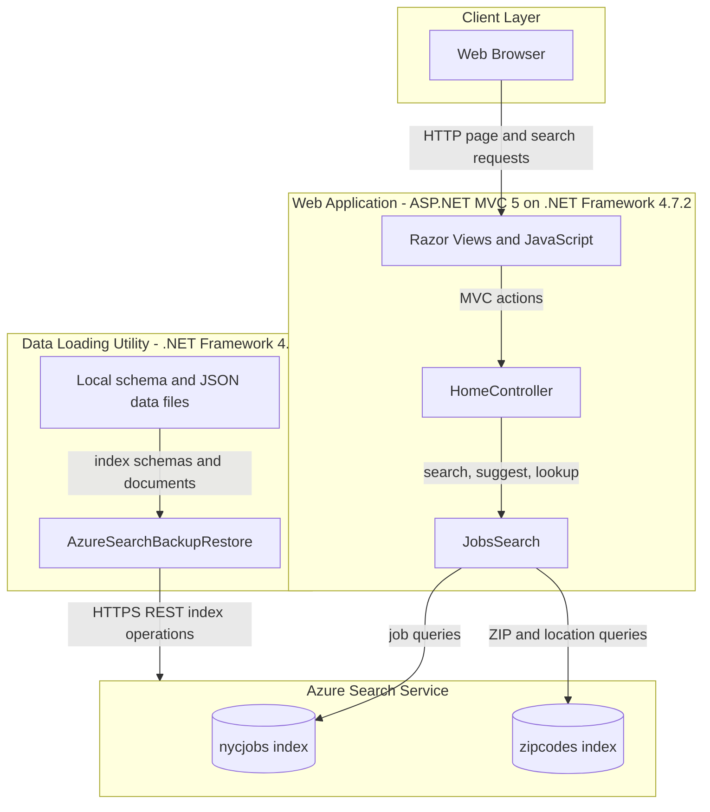
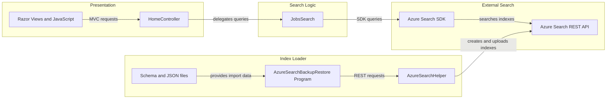

# Architecture Diagram

The repository contains an ASP.NET MVC job-search website and a separate console utility that loads sample data into Azure Search. The website reads job and ZIP-code indexes; the loader creates and populates those indexes from repository data files.

## Application Architecture

### Technology Stack Summary

| Layer | Technology | Version | Purpose |
|---|---|---|---|
| Presentation | ASP.NET MVC and Razor | MVC 5.2.2; Razor 3.2.2 | Server-rendered pages and MVC actions |
| Search access | Azure.Search.Documents SDK | 11.1.1 | Search, suggest, and retrieve indexed documents |
| Data loading | .NET console application and HttpClient | .NET Framework 4.5 | Create indexes and upload sample JSON documents |
| Search storage | Azure Cognitive Search indexes | Configured externally | Store searchable job and ZIP-code documents |

### Data Storage & External Services

There is no relational database or local persistence layer. The website queries the `nycjobs` and `zipcodes` Azure Search indexes; the console utility reads schemas and sample JSON files from the repository and writes index definitions and documents to Azure Search. The website also loads the Bing Maps JavaScript API in the browser.

### Key Architectural Decisions

- The MVC website keeps search orchestration in `JobsSearch`, while the separate loader performs index administration and bulk import.
- Azure Search is the system of record for searchable documents; local JSON files provide sample import data.
- The UI and backend use JSON over synchronous HTTP requests; no message broker or service-discovery mechanism is present.

## Component Relationships

### Component Inventory

| Component | Layer | Type | Responsibility |
|---|---|---|---|
| Razor Views and JavaScript | Presentation | MVC views and browser scripts | Search UI, map display, result rendering, and detail-page requests |
| HomeController | Presentation | MVC controller | Serves pages and returns search, suggestion, and lookup JSON |
| JobsSearch | Search Logic | Search adapter | Calls the job and ZIP-code indexes and configures filters, facets, sorting, and suggestions |
| AzureSearchBackupRestore Program | Index Loader | Console entry point | Deletes/recreates indexes and uploads local schemas and sample documents |
| AzureSearchHelper | Index Loader | REST helper | Builds Azure Search REST requests and serializes JSON |
| Azure Search SDK and REST API | External Search | Cloud service client and service | Stores indexes and processes search and index-management requests |
