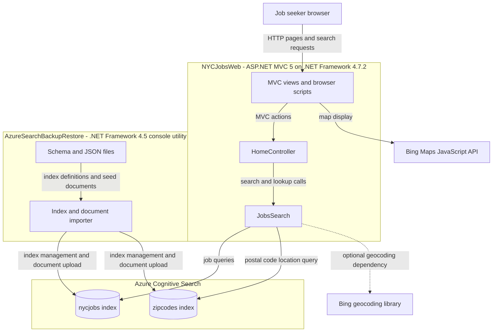
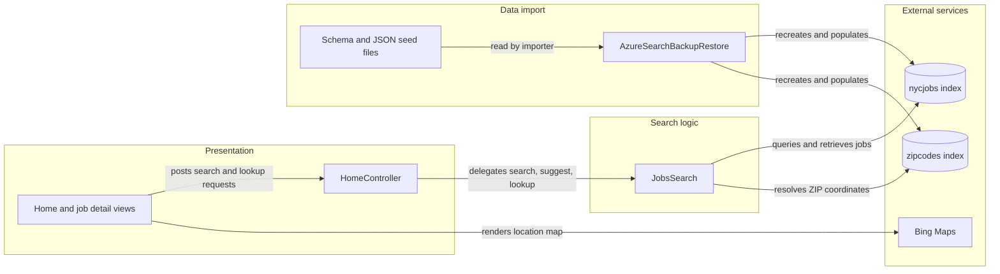

# Architecture Diagram

NYCJobsWeb serves a job-search experience backed by Azure Cognitive Search. A separate console utility rebuilds and populates the search indexes from repository data files.

## Application Architecture

### Technology Stack Summary

| Layer | Technology | Version | Purpose |
|---|---|---|---|
| Presentation | ASP.NET MVC | 5.2.2 | Server-rendered pages and MVC actions |
| Runtime | .NET Framework | 4.7.2 | Web application runtime |
| Search access | Azure.Search.Documents | 11.1.1 | Query, suggest, and retrieve indexed documents |
| Search storage | Azure Cognitive Search | Hosted service | Job and ZIP code indexes |
| Browser mapping | Bing Maps JavaScript API | External/current version | Displays job locations |
| Import utility | .NET Framework console application | 4.5 | Recreates indexes and uploads JSON data |

### Data Storage & External Services

The application has no relational database or ORM. Job postings and postal-code coordinates are held in the Azure Cognitive Search indexes named `nycjobs` and `zipcodes`; the repository also contains JSON seed data and index schemas. The browser uses Bing Maps for map rendering. A Bing geocoding package is declared, although no active use was identified in the reviewed application code.

### Key Architectural Decisions

- The MVC application queries Azure Cognitive Search directly through a search helper rather than an application database.
- Search index creation and sample-data import are handled by a separate console utility.
- The browser combines server-rendered MVC pages with JavaScript-driven search and map updates.

## Component Relationships

### Component Inventory

| Component | Layer | Type | Responsibility |
|---|---|---|---|
| HomeController | Presentation | MVC controller | Serves pages, search results, suggestions, and job lookup responses |
| Home and job detail views | Presentation | Razor views and JavaScript | Collects search criteria and renders results and map pins |
| JobsSearch | Search logic | Search client wrapper | Builds Azure Search requests and accesses job and ZIP indexes |
| AzureSearchBackupRestore | Import | Console utility | Deletes/recreates indexes and uploads JSON documents |
| nycjobs index | External data | Search index | Stores searchable job postings |
| zipcodes index | External data | Search index | Stores postal-code and geographic lookup documents |
| Bing Maps | External integration | Browser API | Displays map and job-location markers |
