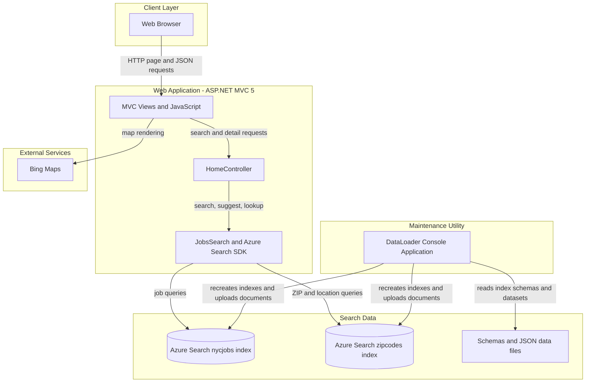
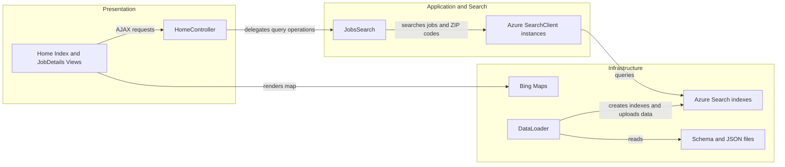

# Architecture Diagram

JobSearch consists of an ASP.NET MVC web application and a separate console utility that provisions and loads Azure Cognitive Search indexes. The web application serves job search pages and uses Azure Search for job and ZIP-code queries.

## Application Architecture

### Technology Stack Summary

| Layer | Technology | Version | Purpose |
|---|---|---|---|
| Presentation | ASP.NET MVC | 5.2.2 | Serves job search and detail views |
| Application | .NET Framework | 4.7.2 | Runs the web application |
| Search access | Azure.Search.Documents | 11.1.1 | Queries Azure Cognitive Search indexes |
| Search data | Azure Cognitive Search | Configured externally | Stores job-posting and ZIP-code indexes |
| Maintenance | .NET Framework console application | 4.5 | Creates indexes and uploads sample JSON records |
| Mapping | Bing Maps JavaScript API | Externally hosted | Displays search-result locations |

### Data Storage & External Services

The application does not use a relational database or ORM. Job postings and ZIP-code geography are stored in two Azure Cognitive Search indexes. A separate console utility reads schema and JSON files from the repository and recreates/populates those indexes. The browser also loads Bing Maps to render job locations.

### Key Architectural Decisions

- Search persistence is delegated to Azure Cognitive Search; the web application queries its indexes directly.
- Index provisioning and sample-data loading are performed by a separate console utility rather than at web-app startup.
- MVC controllers expose both HTML views and JSON responses used by browser-side JavaScript.

## Component Relationships

### Component Inventory

| Component | Layer | Type | Responsibility |
|---|---|---|---|
| Home Index and JobDetails Views | Presentation | MVC views and JavaScript | Collect search criteria, display jobs, and render map details |
| HomeController | Presentation | MVC controller | Serves views and returns search, suggestion, and lookup JSON |
| JobsSearch | Application and Search | Search access class | Builds job/ZIP search requests and calls Azure Search |
| Azure SearchClient instances | Infrastructure | Azure SDK clients | Connect to configured search indexes |
| Azure Search indexes | Infrastructure | External search data store | Store job-posting and ZIP-code documents |
| DataLoader | Infrastructure | Console application | Recreates the two indexes and imports JSON records |
| Schema and JSON files | Infrastructure | Local data files | Define index schemas and sample documents |
| Bing Maps | External Services | Browser API | Displays geolocated search results |
