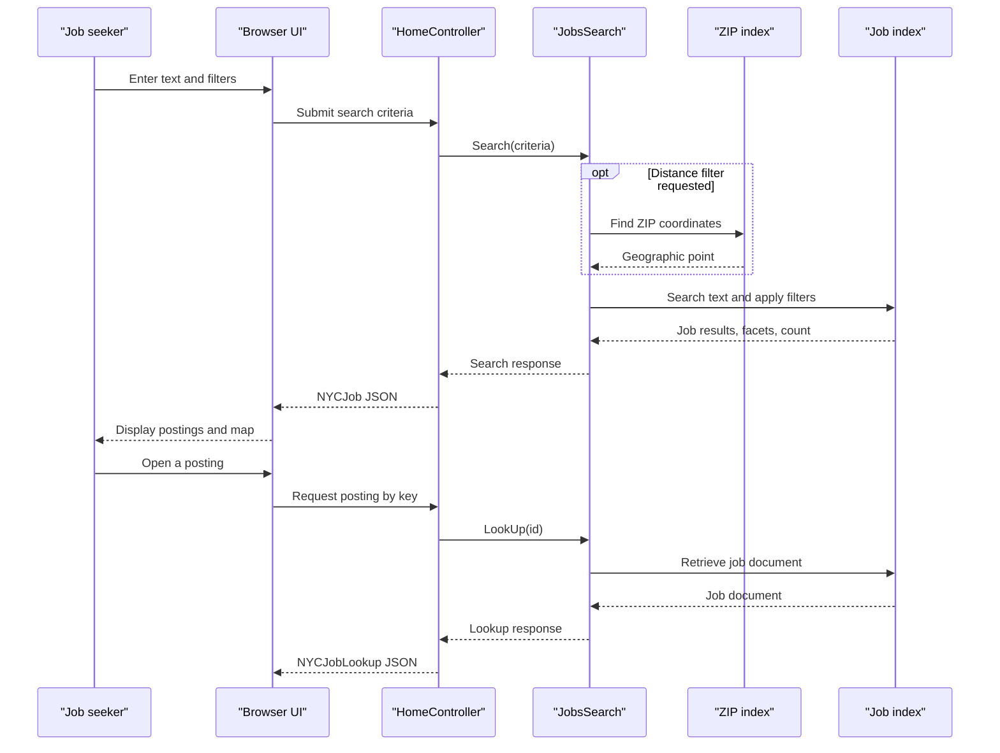

# Core Business Workflows

NYCJobsWeb helps users find New York City job postings by text, facets, salary, and location. Users can browse suggestions, view search results on a map, and retrieve an individual posting.

## Domain Entities

| Entity | Service / Bounded Context | Description | Key Relationships |
|---|---|---|---|
| Job posting | Job Search | A public employment opportunity with searchable text, salary, posting, and location details | Uses a geographic point; may be filtered by ZIP-derived coordinates |
| ZIP code | Location Search | Postal-code location record used to resolve a search center | Supplies coordinates for distance filtering of job postings |
| Search result | Job Search | A job posting returned with facets and a total result count | Returned as a collection for a user query |

## Service-to-Domain Mapping

| Service | Domain Context | Owned Entities | External Dependencies |
|---|---|---|---|
| NYCJobsWeb | Job Search and Location Search | No persistent entities; queries job and ZIP search documents | Azure Cognitive Search, Bing Maps in browser |
| AzureSearchBackupRestore | Search index maintenance | Index definitions and imported document collections | Azure Cognitive Search |

The Azure Search service is the source of truth at runtime. The repository's local JSON files are sample/import content, not a separate service-owned database.

## Primary Workflows

### Workflow 1: Search and filter job postings

1. A user enters search text and optional business-title, posting-type, salary, sort, page, and location criteria.
2. The browser posts the criteria to `Home/Search`.
3. Blank search text is converted to `*`, so it searches the complete index.
4. If distance filtering is enabled, the search logic looks up the ZIP code and uses the returned coordinates to form a geographic filter.
5. Job search applies selected facets and sort options, requests ten results, facets, and a total count, then returns a `NYCJob` response.
6. The browser displays results, pagination, facets, and map pins.

### Workflow 2: Find a posting from suggestions

1. The browser requests suggestions for a typed term from `Home/Suggest`.
2. Azure Search performs suggestion matching against the configured suggester, with fuzzy matching enabled by default.
3. Up to eight suggestion strings are returned and deduplicated by the controller.

### Workflow 3: View job details

1. The browser sends a selected job key to `Home/LookUp`.
2. `JobsSearch` retrieves the document by its key from the `nycjobs` index.
3. The MVC action wraps the document in `NYCJobLookup` and returns JSON for the detail view.

### Workflow 4: Rebuild search data

1. An operator runs the console loader with target Azure Search service settings.
2. The utility deletes and recreates the `zipcodes` and `nycjobs` indexes from their schema files.
3. It reads matching JSON files from the repository and uploads each file to the associated index.

## Cross-Service Data Flows

The web application composes location-aware search within its own request flow: it queries the ZIP index for a geographic point and then includes that point in a query to the job index. There is no gateway or call to another application service. The console loader writes directly to both indexes. If an index request fails, `JobsSearch` catches the exception and returns `null`; there is no business fallback or degraded result contract.

## Business Workflow Sequence

## Business Rules & Decision Logic

- A blank search term becomes the wildcard `*`.
- Search returns at most ten documents per request and includes total count and facets.
- Business-title, posting-type, salary, and geographic-distance filters are optional.
- Salary ranges are calculated in 50,000-unit intervals.
- Sort modes include featured relevance, salary ascending/descending, and most recent posting.
- Distance search runs only when the requested maximum distance is greater than zero.
- Suggestions default to fuzzy matching and request at most eight candidates.
- The importer deletes existing indexes before recreating and populating them; it is an operational maintenance workflow, not an end-user write workflow.
- No dedicated validation framework, explicit authorization rules, audit trail, transaction management, or state-transition model was identified.
