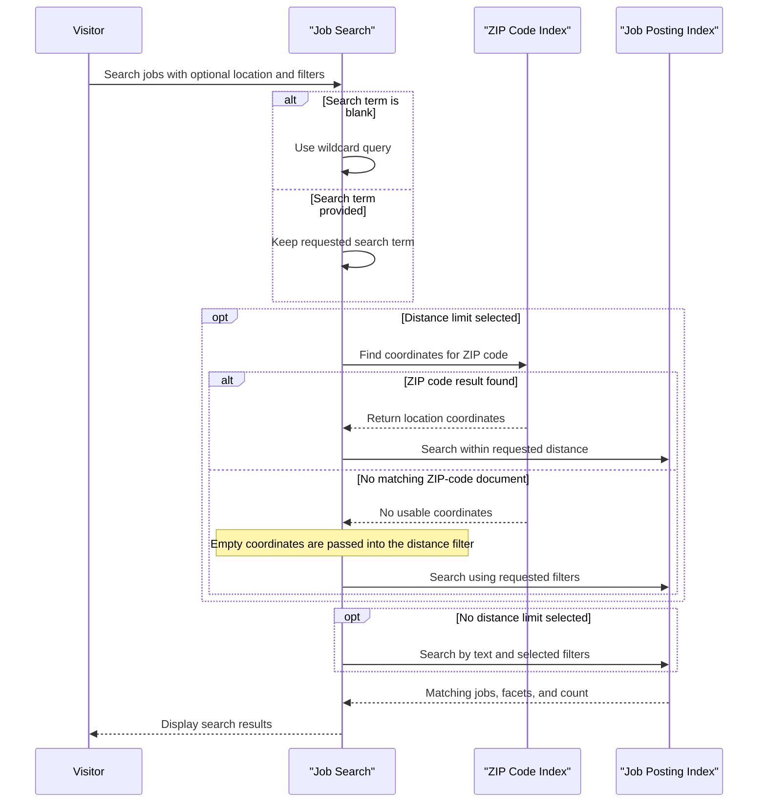

# Core Business Workflows

The application helps users discover New York City job postings by text, title, posting type, salary, and location. A separate utility reloads the job and ZIP-code search data from local files.

## Domain Entities

| Entity | Service / Bounded Context | Description | Key Relationships |
|---|---|---|---|
| Job Posting | NYCJobsWeb / Job Search | Public employment listing presented to job seekers | Associated with an agency, posting and salary details, and optional geographic coordinates |
| ZIP Code | NYCJobsWeb / Location Search | Postal area used to find coordinates for distance-based searches | Supplies a geographic point used to constrain job searches |
| Search Result | NYCJobsWeb / Job Search | A matching job document returned from the search index | Included in a job search response with facets and total count |

## Service-to-Domain Mapping

| Service | Domain Context | Owned Entities | External Dependencies |
|---|---|---|---|
| NYCJobsWeb | Job Search and Location Search | No persistent ownership; reads job postings and ZIP-code documents | Azure AI Search `nycjobs` and `zipcodes` indexes |
| AzureSearchBackupRestore | Search Data Import | No domain ownership; provisions and populates indexes | Azure AI Search and local schemas/JSON files |

## Primary Workflows

### Workflow 1: Search Job Postings

1. A visitor enters a search term and optional facets, sort order, page, and location criteria.
2. An empty search term is converted to a wildcard search.
3. If a distance limit is selected, the application looks up the supplied ZIP code and obtains its coordinates.
4. The application queries the job index with the term, selected facets, sort order, and optional distance filter.
5. The results, facets, and total count are returned together to the client.

### Workflow 2: Reload Search Index Data

1. An operator starts the console importer with the target search service configured.
2. For each of the `zipcodes` and `nycjobs` indexes, the importer attempts to delete the index, creates it from the matching local schema, and submits the matching JSON documents.
3. The importer reports request errors to the console. No transactional rollback or automatic retry is implemented.

## Cross-Service Data Flows

The web application uses ZIP-code documents to obtain coordinates, then applies those coordinates to a separate job-index search. This is an intra-application composition across two indexes; no distinct backend service aggregation, message exchange, or fallback path was identified. During reloading, the console utility is the writer for the same two indexes that the web application reads.

## Business Workflow Sequence

## Business Rules & Decision Logic

- A blank query is interpreted as a wildcard so users can browse all indexed postings.
- A ZIP-code lookup is performed only when a positive distance limit is requested.
- Salary-range filters represent an interval starting at the selected amount and ending 50,000 above it.
- Supported ordering choices include featured, descending salary, ascending salary, and most recent posting.
- The featured ordering uses the index scoring profile, including posting freshness, featured tags, and distance.
- Search and import failures are reported through console output or `null` search results; no retry, compensation, transaction, or audit workflow was identified.
- No role-based or resource-level business authorization checks were identified in the inspected workflow code.
