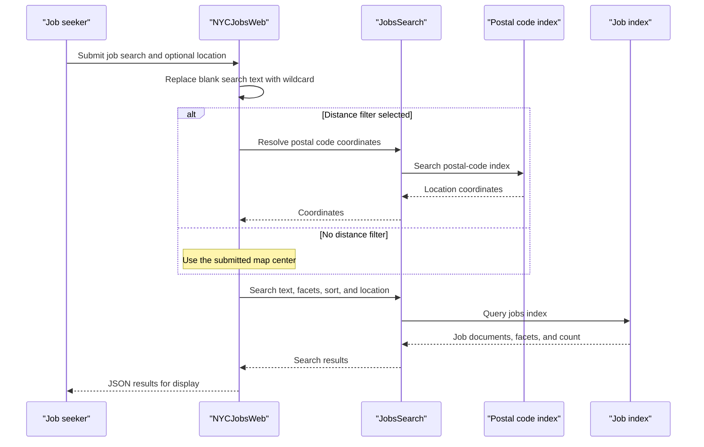

# Core Business Workflows

The application helps users search publicly sourced New York City job postings by text, title, posting type, salary, and location. A separate utility loads sample job postings and postal-code records into Azure AI Search.

## Domain Entities

| Entity | Service / Bounded Context | Description | Key Relationships |
|---|---|---|---|
| JobPosting | NYCJobsWeb / Job Search | A public listing with role, agency, salary, location, and description | Associated with a geographic point; searchable by facets |
| PostalCode | NYCJobsWeb / Location Search | A postal-code lookup entry with locality and coordinates | Supplies a point used for distance-based job filtering |

## Service-to-Domain Mapping

| Service | Domain Context | Owned Entities | External Dependencies |
|---|---|---|---|
| NYCJobsWeb | Job Search | Reads JobPosting and PostalCode index documents | Azure AI Search |
| DataLoader | Search Data Import | Creates and populates the job and postal-code indexes | Azure AI Search and repository sample data |

Azure AI Search is the source of truth for the indexed records. DataLoader imports checked-in sample records; the web application does not mutate the index.

## Primary Workflows

### Workflow 1: Search job postings

1. The browser submits search text, selected facets, sort option, page, and map/location values to `Home/Search`.
2. Blank search text is treated as a wildcard search. If a maximum distance is selected, the application first queries the postal-code index for coordinates.
3. `JobsSearch` builds Azure Search text, facet, sort, and optional spatial filter parameters.
4. Azure AI Search returns job documents, facets, and a total count; the MVC action returns the data as JSON for the page to display.

### Workflow 2: View job details

1. The browser submits a job document ID to `Home/LookUp`.
2. `JobsSearch` retrieves the document from the job index.
3. The action returns a JSON wrapper, and the detail page displays the selected job fields.

### Workflow 3: Load sample indexes

1. An operator runs DataLoader with Azure Search service credentials configured in App.config.
2. The utility deletes each target index if present, creates the index from its checked-in schema, and uploads matching JSON files.
3. The new indexes are then available to the web application's search and location lookups.

## Cross-Service Data Flows

The web application and loader communicate through the Azure Search indexes, not direct process calls or a message broker. The loader owns index creation and sample-data upload; the web application reads jobs and postal-code records. The spatial search flow uses a postal-code result to derive coordinates and then applies a distance constraint to the job search. No downstream-service fallback or circuit breaker was identified.

## Business Workflow Sequence

## Business Rules & Decision Logic

- Empty search text is converted to `*` so users receive an unrestricted text search.
- A positive maximum distance triggers postal-code coordinate lookup and a spatial distance filter.
- Supported sort choices include featured, salary ascending/descending, and most recent.
- Job title, posting type, and salary facets are combined when supplied.
- DataLoader replaces its target indexes before importing sample data; no transaction or rollback behavior is implemented.
- No business-level authentication or authorization rule was identified.
