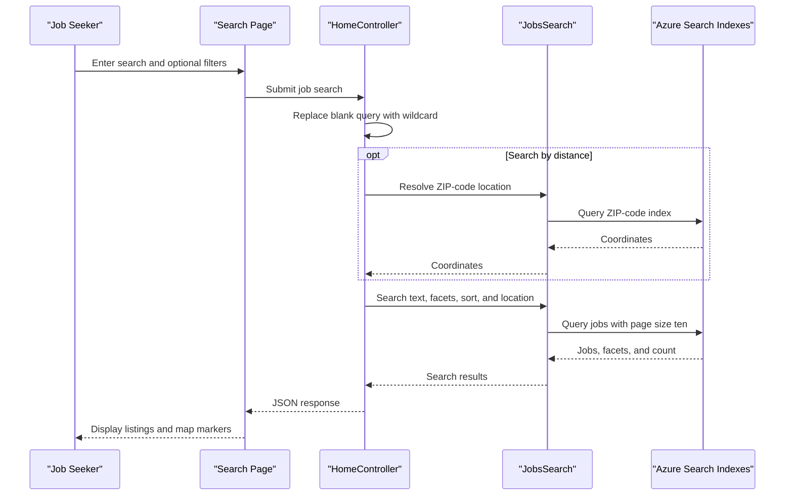

# Core Business Workflows

JobSearch helps users find New York City job postings by text, title, posting type, salary, and location. A separate utility creates the search indexes and loads the repository's sample job and ZIP-code data.

## Domain Entities

| Entity | Service / Bounded Context | Description | Key Relationships |
|---|---|---|---|
| JobPosting | NYCJobsWeb / Job Search | Public job vacancy with role, agency, salary, and location information | Has geographic coordinates used for radius search |
| ZipCode | NYCJobsWeb / Location Search | ZIP-code location and geographic center used for distance queries | Provides a location reference for job searches |

## Service-to-Domain Mapping

| Service | Domain Context | Owned Entities | External Dependencies |
|---|---|---|---|
| NYCJobsWeb | Job Search | Reads JobPosting and ZipCode index documents; does not own persistent storage | Azure Cognitive Search, Bing Maps |
| DataLoader | Search Data Provisioning | Creates and populates the JobPosting and ZipCode indexes | Azure Cognitive Search REST API; local schema and JSON files |

## Primary Workflows

### Workflow 1: Search for Job Postings

1. A user enters a free-text search, optionally selecting title, posting type, salary, sort, or distance filters.
2. `HomeController.Search` replaces a blank query with `*`, then delegates to `JobsSearch`.
3. When a distance is selected, `JobsSearch.SearchZip` resolves the ZIP code to coordinates.
4. `JobsSearch.Search` queries the job index with the selected filters, geographic constraint, facets, sort order, and a page size of ten.
5. The controller returns an `NYCJob` JSON response. The browser renders job cards, pagination, and map markers.

### Workflow 2: View Job Details

1. The user selects a job listing.
2. The browser posts its job ID to `HomeController.LookUp`.
3. `JobsSearch.LookUp` retrieves the document from the job index.
4. The controller returns an `NYCJobLookup` JSON response and the page renders the job details.

### Workflow 3: Provision Search Data

1. An operator runs the DataLoader console application with target Azure Search settings.
2. The utility deletes and recreates the `zipcodes` and `nycjobs` indexes from the repository schemas.
3. It uploads matching JSON documents from `NYCJobsWeb/Schema_and_Data`.

## Cross-Service Data Flows

The web application reads job and ZIP-code documents from Azure Search. For distance filtering, it first resolves a ZIP code to coordinates and uses those coordinates in the job-index query; it does not join through a relational database. DataLoader separately provisions both indexes from local files. If a search request fails, `JobsSearch` catches the exception and returns `null`; callers do not define a business fallback for that result.

## Business Workflow Sequence

## Business Rules & Decision Logic

- A blank search string is treated as a wildcard search.
- Distance filtering first resolves the supplied ZIP code, then filters job postings by geographic distance.
- Search results use a fixed page size of ten and support featured, salary, and posting-date ordering.
- Search facets are available for business title, posting type, and salary range.
- No user authentication, role-based authorization, approval process, or business transaction boundary was identified.
- Search and lookup exceptions are caught in the data-access class; no structured business error response or fallback result is defined.
