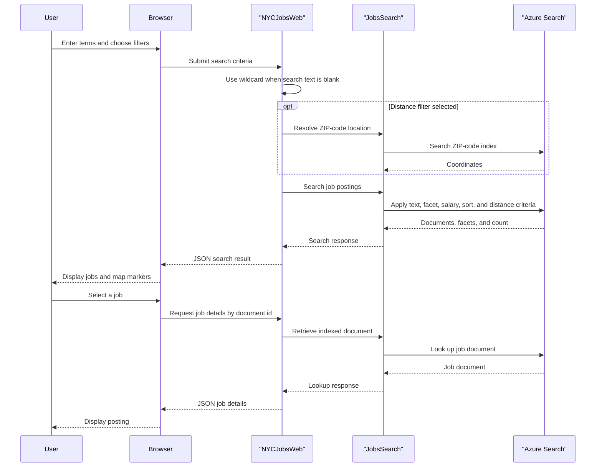

# Core Business Workflows

The application helps users find and inspect sample New York City job postings. Users can search and filter postings, explore results by location, and open an individual job record; a separate utility maintains the sample search indexes.

## Domain Entities

| Entity | Service / Bounded Context | Description | Key Relationships |
|---|---|---|---|
| Job posting | NYCJobsWeb / Job Search | Public job advertisement indexed for search, facets, sorting, and detail display | May be associated with a geographic point; no relational link is modeled |
| ZIP-code location | NYCJobsWeb / Location Search | Postal-code record used to obtain coordinates for distance filtering | Supplies location data to a job search; stored in a separate index |
| Search result | NYCJobsWeb / Search Presentation | A job posting plus search metadata such as facets and count | Returned by the job search index |

## Service-to-Domain Mapping

| Service | Domain Context | Owned Entities | External Dependencies |
|---|---|---|---|
| NYCJobsWeb | Job Search and Location Search | No database-owned entities; reads indexed job and ZIP-code documents | Azure Cognitive Search |
| AzureSearchBackupRestore | Sample Index Maintenance | Creates and populates job and ZIP-code indexes | Azure Cognitive Search; local schema and JSON files |

The website is the read/query interface. The loader is the only component shown modifying the search indexes; there is no service-to-service domain exchange beyond the shared search service.

## Primary Workflows

### Workflow 1: Search and Refine Job Postings

1. The browser submits the search text, selected facets, sort mode, page, and location values to the MVC search action.
2. If the query is blank, the application treats it as a wildcard search. If a positive distance is selected, the application searches the ZIP-code index to obtain a center point.
3. `JobsSearch` constructs Azure Search options, including a result limit, facets, filters, and selected ordering, then queries the job index.
4. The controller returns the results, facets, and total count as JSON. The browser refreshes result cards, counts, filters, paging, and map markers.

### Workflow 2: Inspect a Job Posting

1. A user selects a result and the browser requests the job-details page.
2. The page submits the selected document ID to the lookup action.
3. `JobsSearch` retrieves the document from the job index and the controller returns it as JSON for display.

### Workflow 3: Load Sample Index Data

1. The operator runs the console loader with Azure Search target settings.
2. For each of the `zipcodes` and `nycjobs` indexes, the loader attempts to delete the existing index, posts the schema, and uploads matching local JSON files.
3. The loader prints request errors to the console; no rollback, retry, or transaction spanning the index operations is implemented.

## Cross-Service Data Flows

There is no API gateway or multi-service aggregation. The web application obtains job and ZIP-code data from separate Azure Search indexes. A distance-filtered query first resolves the ZIP code to a geographic point, then passes that point to the job-index search. The index loader writes both indexes from local sample data; no message or event synchronizes changes.

## Business Workflow Sequence

## Business Rules & Decision Logic

- A blank search string becomes `*`, which searches all available job documents.
- A positive distance invokes ZIP-code lookup and adds a geographic-distance condition to the job query.
- Business-title and posting-type values are applied as facets/filters; a salary facet selects a 50,000-unit range.
- Sorting supports featured relevance, ascending or descending salary, and most recent posting.
- The search requests a page size of 10. The loader refreshes indexes by deleting and recreating them before upload.
- Search and REST exceptions are caught and written to console output; there is no business-level retry, compensation, audit trail, or transaction across multiple index operations.
