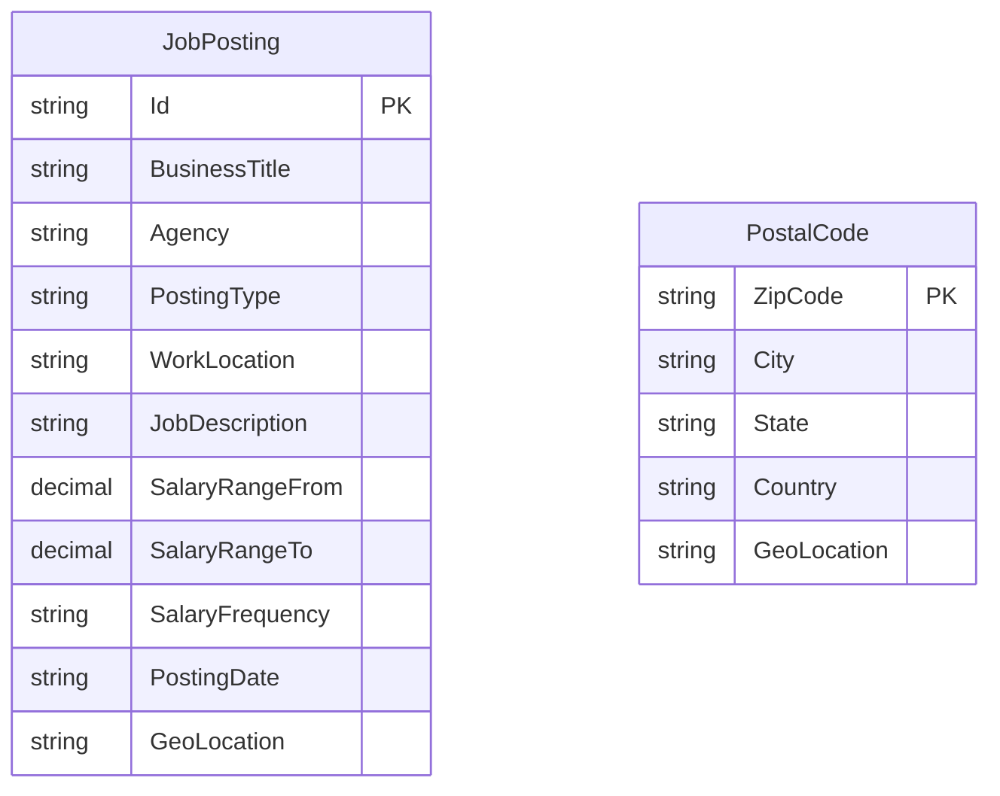

# Data Architecture & Persistence Layer

The application does not use a relational ORM or repository layer. Its persistent store is Azure AI Search, with job postings and postal-code location data represented as indexed documents.

## Database Configuration

| Service/Module | DB Type | Profile | Driver | Connection | Migration Tool |
|---|---|---|---|---|---|
| NYCJobsWeb | Azure AI Search | Not profile-based | Azure.Search.Documents 11.1.1 | Endpoint and API key from Web.config | None identified |
| DataLoader | Azure AI Search | Not profile-based | HTTP client / Azure Search REST API | Service name and API key from App.config | Index definitions are JSON schema files |

No SQL database, database migration tool, or ORM configuration was found.

## Data Ownership per Service

| Service | Tables Owned | ORM Framework | Caching | Notes |
|---|---|---|---|---|
| NYCJobsWeb | Reads `nycjobs` and `zipcodes` indexes | None; Azure Search SDK | None identified | Queries job and postal-code documents |
| DataLoader | Creates and populates `nycjobs` and `zipcodes` indexes | None; HTTP REST calls | None identified | Uses local schema and JSON files as import input |

## Entity Model

The application uses Azure Search `SearchDocument` objects rather than mapped ORM entities. Index field definitions are stored in `NYCJobsWeb/Schema_and_Data/*.schema`; the documents contain job-posting data and postal-code/geolocation data. No entity relationships, transactions, or repository interfaces were identified.

## Key Repository Methods

| Service | Repository | Notable Methods | Purpose |
|---|---|---|---|
| NYCJobsWeb | `JobsSearch` (`NYCJobsWeb/JobsSearch.cs`) | `Search`, `SearchZip`, `Suggest`, `LookUp` | Runs Azure Search queries, suggestions, and document lookup |
| DataLoader | None | `CreateTargetIndex`, `ImportFromJSON` | Creates indexes and submits JSON documents; methods are not repositories |

## Caching Strategy

No application cache, distributed cache, or explicit query-result cache was identified. Search clients are held in static fields in the web application; this is client reuse, not a result cache.

## Data Ownership Boundaries

Both projects use the same Azure AI Search service and its two indexes. The web application is read-oriented; DataLoader is a separate import utility that creates indexes, deletes existing indexes, and uploads sample data. No cross-service database access, CQRS pattern, or shared relational database was identified.

### Data Classification & Sensitivity

| Entity | Sensitive Fields | Classification (PII/PHI/PCI/None) | Controls in Place |
|---|---|---|---|
| JobPosting | Work location and public job-posting content; no personal fields identified in the model/schema | None identified | No field-level protection is configured |
| PostalCode | Postal code, city, state, country, and coordinates | None identified | No field-level protection is configured |

The documented model describes public job listings and geographic lookup data; no PHI or PCI data was identified.
