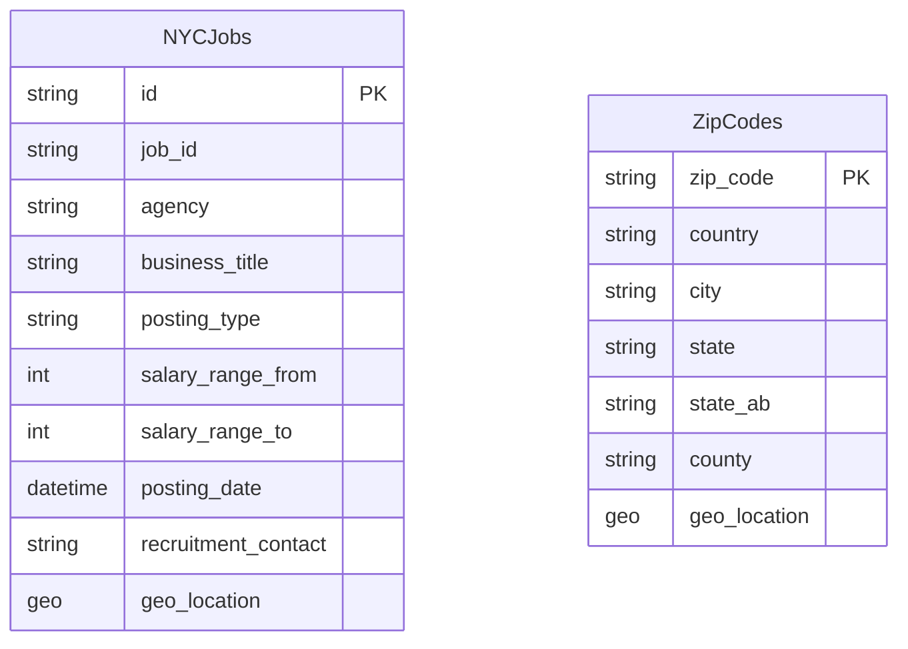

# Data Architecture & Persistence Layer

The application has two Azure AI Search indexes and no relational database or ORM-managed entity model. The web application reads search documents, while a separate utility provisions index schemas and uploads JSON data.

## Database Configuration

| Service/Module | DB Type | Profile | Driver | Connection | Migration Tool |
|---|---|---|---|---|---|
| NYCJobsWeb | Azure AI Search | No profiles found | Azure.Search.Documents SDK | Azure Search endpoint and key supplied through application settings | None identified |
| AzureSearchBackupRestore | Azure AI Search | No profiles found | HttpClient and Azure Search REST API | Service name and key supplied through application settings | Custom console utility; reads local schema JSON |

No relational database, connection pool, schema migration framework, or seed-data framework was identified. The repository contains local schema and document JSON files used to initialize the search indexes.

## Data Ownership per Service

| Service | Tables Owned | ORM Framework | Caching | Notes |
|---|---|---|---|---|
| NYCJobsWeb | None; reads `nycjobs` and `zipcodes` indexes | None | None identified | Search results use Azure SDK `SearchDocument` |
| AzureSearchBackupRestore | None; provisions and writes to `nycjobs` and `zipcodes` indexes | None | None | Loads schemas and bulk document payloads from local files |
| Azure AI Search | `nycjobs` and `zipcodes` search indexes | Managed search service | Service-managed | Index fields and keys are defined by local schema files |

## Entity Model

The index schemas define two independent search document types. No foreign-key or relational relationships are declared.

`NYCJobs` is defined in `NYCJobsWeb/Schema_and_Data/nycjobs.schema`; `ZipCodes` is defined in `NYCJobsWeb/Schema_and_Data/zipcodes.schema`. The application represents documents as Azure Search `SearchDocument` values rather than dedicated persisted entity classes. No ORM mappings or transaction management configuration were identified.

## Key Repository Methods

| Service | Repository | Notable Methods | Purpose |
|---|---|---|---|
| NYCJobsWeb | None | `JobsSearch.Search`, `SearchZip`, `Suggest`, `LookUp` | Direct Azure Search SDK calls; no repository abstraction is present |
| AzureSearchBackupRestore | None | `LaunchImportProcess`, `DeleteIndex`, `CreateTargetIndex`, `ImportFromJSON` | Uses Azure Search REST calls to provision indexes and upload documents |

## Caching Strategy

No application-level cache provider, cache configuration, or caching pattern was identified. The repository does not configure search-result or session caching.

## Data Ownership Boundaries

The Azure AI Search service owns the two indexes. The web application accesses them through the Azure Search SDK, while the independent importer accesses the same configured service through its REST API and local data files. No shared relational database, cross-service database access, CQRS implementation, or transactional data boundary was identified.

### Data Classification & Sensitivity

| Entity | Sensitive Fields | Classification (PII/PHI/PCI/None) | Controls in Place |
|---|---|---|---|
| NYCJobs | `recruitment_contact`, `to_apply` | Potential public contact information (PII) | Application-level encryption, masking, and field-level access controls are not configured in the inspected project files; index access uses a configured API key |
| ZipCodes | Geographic and postal-location fields | None identified | No application-level sensitive-data controls identified |
