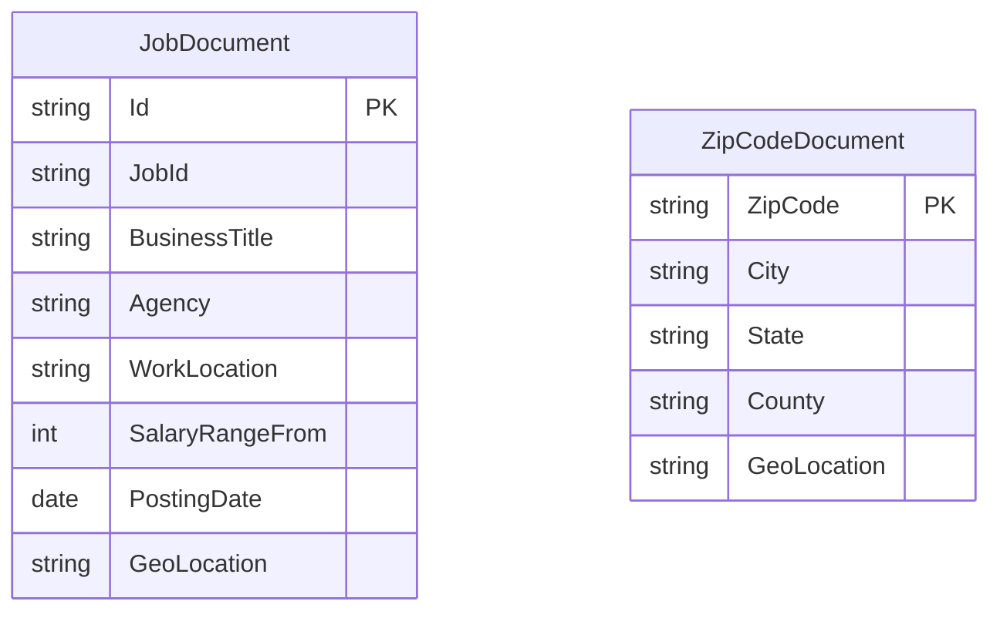

# Data Architecture & Persistence Layer

The application has no relational database or ORM. Its data layer consists of Azure Search indexes for job and ZIP-code documents, plus local JSON files used by the index-loader utility.

## Database Configuration

| Service/Module | DB Type | Profile | Driver | Connection | Migration Tool |
|---|---|---|---|---|---|
| NYCJobsWeb | Azure Cognitive Search | No profiles found | Azure.Search.Documents SDK | Endpoint and API key are expected from web configuration | None |
| AzureSearchBackupRestore | Azure Cognitive Search | No profiles found | HttpClient and REST API | Service name and API key are expected from `App.config` | None; indexes are deleted and recreated from schema files |

## Data Ownership per Service

| Service | Tables Owned | ORM Framework | Caching | Notes |
|---|---|---|---|---|
| NYCJobsWeb | No database tables; reads `nycjobs` and `zipcodes` indexes | None | None found | Search and lookup operations are issued through `JobsSearch` |
| AzureSearchBackupRestore | Writes `nycjobs` and `zipcodes` index documents | None | None found | Local schemas and JSON data files are the import source |

## Entity Model

`JobDocument` and `ZipCodeDocument` represent separate Azure Search indexes and have no declared relational relationship. The C# response wrappers are `NYCJob` and `NYCJobLookup`; indexed document structure is defined in `NYCJobsWeb/Schema_and_Data/nycjobs.schema` and `zipcodes.schema`.

## Key Repository Methods

| Service | Repository | Notable Methods | Purpose |
|---|---|---|---|
| NYCJobsWeb | `JobsSearch` (`NYCJobsWeb/JobsSearch.cs`) | `Search(...)`, `SearchZip(string)`, `Suggest(string, bool)`, `LookUp(string)` | Search job documents, locate ZIP coordinates, return suggestions, and retrieve a job document |
| AzureSearchBackupRestore | No repository abstraction | `SendSearchRequest(...)` in `AzureSearchHelper` | Sends index-management and document-upload REST requests |

No repository interfaces or custom SQL queries were found.

## Caching Strategy

No application cache, cache provider, TTL, or cache-aside behavior was identified. Azure Search client instances are held in static fields in the web application, but search results are not cached by application code.

## Data Ownership Boundaries

Both the website and loader access the same externally managed Azure Search service. The website reads index data; the loader owns the operational workflow that deletes/recreates indexes and uploads documents from local JSON files. There is no cross-service database access or separate read/write store.

### Data Classification & Sensitivity

| Entity | Sensitive Fields | Classification (PII/PHI/PCI/None) | Controls in Place |
|---|---|---|---|
| JobDocument | Recruitment contact information may include business contact details | Potential PII | No field-level masking or application-managed encryption is documented; Azure service controls are external to the repository |
| ZipCodeDocument | Geographic location and postal data | None identified | No application-specific controls documented |

