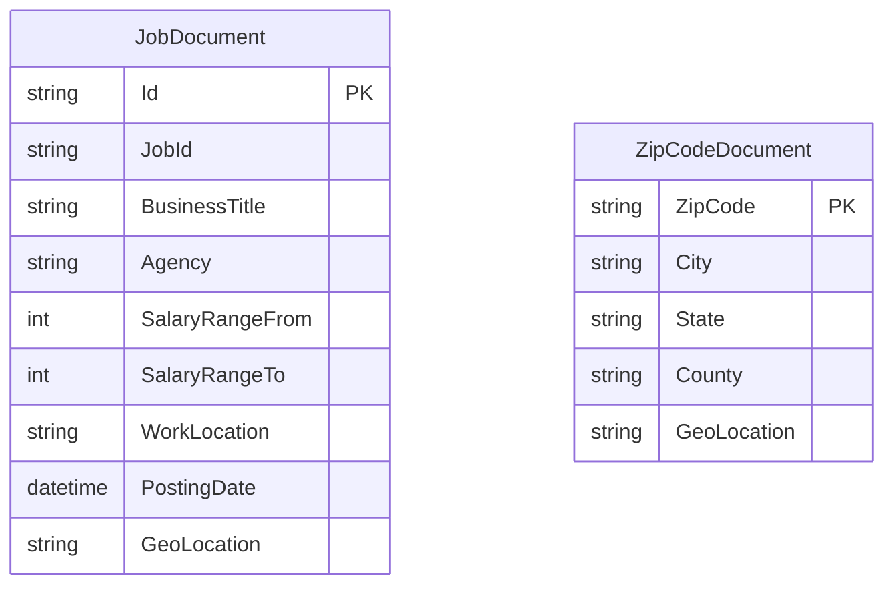

# Data Architecture & Persistence Layer

The application has no relational database, ORM, or repository layer. Its persistent data is stored in Azure Cognitive Search indexes, with job and ZIP code documents also supplied as static schema and JSON files.

## Database Configuration

| Service/Module | DB Type | Profile | Driver | Connection | Migration Tool |
|---|---|---|---|---|---|
| NYCJobsWeb | Azure Cognitive Search | Single configured endpoint | Azure.Search.Documents SDK | Search endpoint and API credential are expected in web configuration; the endpoint key read by code is not present under that name in the checked-in configuration | None |
| AzureSearchBackupRestore | Azure Cognitive Search | Target service configured in `App.config` | HTTP client and Azure Search REST API | HTTPS endpoint derived from configured service name | Utility deletes and recreates indexes from checked-in schema files |

No SQL database, relational driver, schema migration framework, or transaction manager was detected.

## Data Ownership per Service

| Service | Tables Owned | ORM Framework | Caching | Notes |
|---|---|---|---|---|
| NYCJobsWeb | `nycjobs` and `zipcodes` Azure Search indexes are queried, not owned by a relational ORM | None | None detected | Reads job records and ZIP coordinate data |
| AzureSearchBackupRestore | Recreates and populates `nycjobs` and `zipcodes` indexes | None | None detected | Uses local `.schema` and JSON seed files |

## Entity Model

The principal persisted models are index documents rather than application-defined ORM entities. `SearchDocument` is the Azure SDK's flexible document type; `NYCJob` and `NYCJobLookup` are response wrappers.

The two Azure Search indexes do not have an enforced entity relationship. A ZIP code lookup supplies coordinates for distance filtering against job documents. The index definitions are in `NYCJobsWeb/Schema_and_Data/nycjobs.schema` and `NYCJobsWeb/Schema_and_Data/zipcodes.schema`.

## Key Repository Methods

| Service | Repository | Notable Methods | Purpose |
|---|---|---|---|
| NYCJobsWeb | `JobsSearch` (`NYCJobsWeb/JobsSearch.cs`) | `Search`, `SearchZip`, `Suggest`, `LookUp` | Queries job postings, obtains postal coordinates, supplies suggestions, and retrieves one document |
| AzureSearchBackupRestore | None | `DeleteIndex`, `CreateTargetIndex`, `ImportFromJSON` | Deletes/recreates indexes and uploads matching JSON seed files |

No repository interface or custom SQL query was detected.

## Caching Strategy

No cache provider, cache annotations, TTL, or query-result cache was found. Search requests are sent directly to Azure Cognitive Search.

## Data Ownership Boundaries

The web application and loader use a single Azure Search service endpoint with logically separate `nycjobs` and `zipcodes` indexes. There is no application-level database-per-service boundary, cross-service API, or CQRS implementation. Distance search reads a ZIP document to obtain a geographic point and uses it in a subsequent query against job postings. The loader is the only component that changes index definitions and bulk document contents.

### Data Classification & Sensitivity

| Entity | Sensitive Fields | Classification (PII/PHI/PCI/None) | Controls in Place |
|---|---|---|---|
| JobDocument | Public posting details; some source records may include recruitment contact information | Public job content; contact details may be PII | No field-level masking or application-managed encryption controls found; Azure service-side protections are outside repository evidence |
| ZipCodeDocument | ZIP code, city, state, county, coordinates | None identified | No application-specific controls found |

