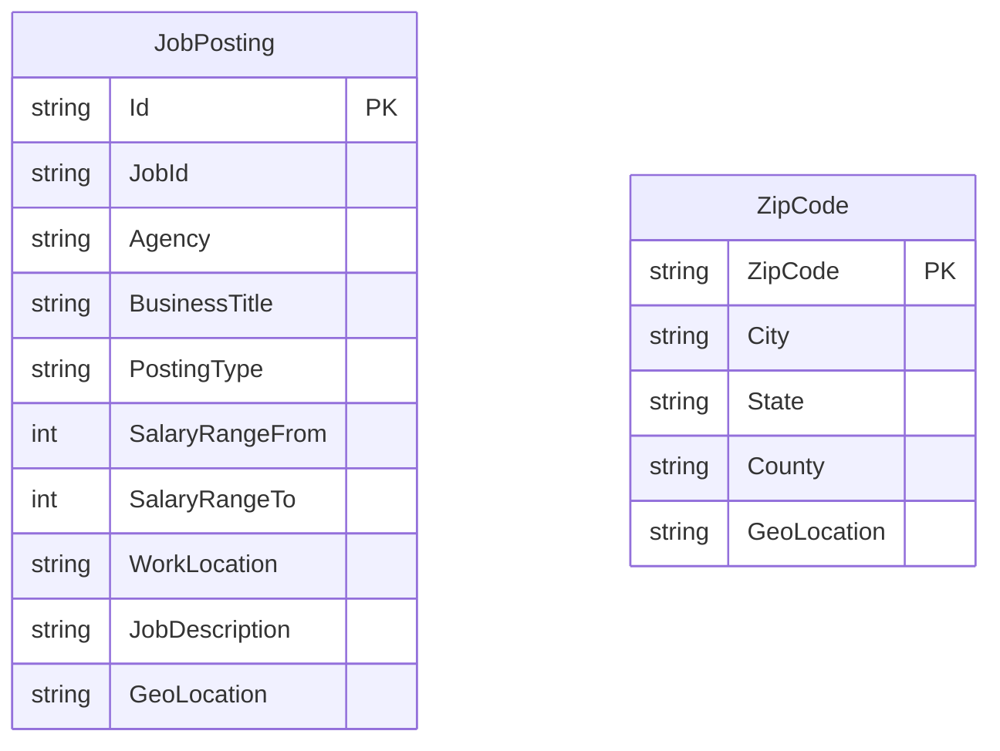

# Data Architecture & Persistence Layer

The application stores searchable job postings and ZIP-code location data in two Azure Cognitive Search indexes. There is no relational ORM or application-managed database; the repository contains index schemas and JSON seed data.

## Database Configuration

| Service/Module | DB Type | Profile | Driver | Connection | Migration Tool |
|---|---|---|---|---|---|
| NYCJobsWeb | Azure Cognitive Search | No profiles found | Azure.Search.Documents SDK | Search endpoint and key are read from application settings | None; index schema files define index shape |
| DataLoader | Azure Cognitive Search REST API | No profiles found | HttpClient | Service name and API key are read from App.config; requests use HTTPS | None; utility deletes and recreates indexes |

The indexes are named `nycjobs` and `zipcodes`. The DataLoader uses local schema JSON files to create them and imports matching JSON records from `NYCJobsWeb/Schema_and_Data`.

## Data Ownership per Service

| Service | Tables Owned | ORM Framework | Caching | Notes |
|---|---|---|---|---|
| NYCJobsWeb | None; reads `nycjobs` and `zipcodes` indexes | None | None detected | Queries Azure Search through `JobsSearch` |
| DataLoader | Creates/populates `nycjobs` and `zipcodes` indexes | None | None | Index ownership is operational; source documents are local JSON files |

## Entity Model

`JobPosting` represents documents in the `nycjobs` Azure Search index, as described by `NYCJobsWeb/Schema_and_Data/nycjobs.schema`. `ZipCode` represents location documents in the `zipcodes` index, described by `NYCJobsWeb/Schema_and_Data/zipcodes.schema`. They are independent index documents; the application uses geographic coordinates to filter job postings rather than a persisted foreign-key relationship. There are no ORM entities, transactions, or repository interfaces.

## Key Repository Methods

| Service | Repository | Notable Methods | Purpose |
|---|---|---|---|
| NYCJobsWeb | `JobsSearch` (`NYCJobsWeb/JobsSearch.cs`) | `Search(...)` | Queries job postings with facets, sort criteria, and optional geographic distance |
| NYCJobsWeb | `JobsSearch` (`NYCJobsWeb/JobsSearch.cs`) | `SearchZip(string zipCode)` | Retrieves ZIP-code coordinates for radius search |
| NYCJobsWeb | `JobsSearch` (`NYCJobsWeb/JobsSearch.cs`) | `Suggest(string searchText, bool fuzzy)` | Returns search suggestions |
| NYCJobsWeb | `JobsSearch` (`NYCJobsWeb/JobsSearch.cs`) | `LookUp(string id)` | Retrieves one job document by ID |

## Caching Strategy

No cache provider, cache annotations, TTL, or explicit query cache was detected. Azure Search SDK clients are held in static fields, but this is client reuse rather than a result cache.

## Data Ownership Boundaries

Both indexes are hosted by the same configured Azure Search service. NYCJobsWeb reads from those indexes; DataLoader is the repository's write/provisioning utility and loads the shared index data from local JSON files. No cross-service database access, CQRS, or separate transactional data store was detected.

### Data Classification & Sensitivity

| Entity | Sensitive Fields | Classification (PII/PHI/PCI/None) | Controls in Place |
|---|---|---|---|
| JobPosting | Public job posting content and work locations | None detected | No application-level data encryption or masking configuration found; service-level controls are external |
| ZipCode | ZIP code, city, state, county, and geographic coordinates | None detected | No application-level data encryption or masking configuration found; service-level controls are external |

No personal applicant, health, or payment data was identified in the indexed data model.
