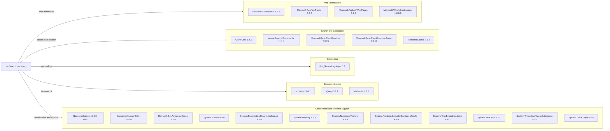

# Dependency Map

The repository contains 25 declared NuGet package entries across the web application and its separate data-loader utility. The dependencies are primarily an older ASP.NET MVC stack, Azure Search clients, browser libraries, and framework support packages.

## Dependencies

### Dependency Summary

| Category | Count | Key Libraries | Notes |
|---|---:|---|---|
| Web Frameworks | 4 | ASP.NET MVC, Razor, WebPages, Web Infrastructure | Classic System.Web application |
| Search and Geospatial | 5 | Azure.Search.Documents, Azure.Core, Microsoft.Spatial, Microsoft.Rest clients | Azure Search SDKs and supporting clients |
| Geocoding | 1 | BingGeocodingHelper | Declared helper package |
| Browser Libraries | 3 | Bootstrap, jQuery, Modernizr | Legacy browser dependencies |
| Serialization and Runtime Support | 12 | Newtonsoft.Json, System.Text.Json, System.Memory and related packages | Newtonsoft.Json is on two different versions across projects |

### Version & Compatibility Risks

Both projects use legacy, non-SDK project files: the web app targets .NET Framework 4.7.2 and the utility targets .NET Framework 4.5. The MVC/Razor stack and browser packages are old, and the separate utility pins Newtonsoft.Json 9.0.1 while the web app uses 10.0.3. Moving to modern .NET requires replacing or substantially adapting System.Web MVC and reviewing package compatibility.

### Notable Observations

- The web application declares 24 package entries; the separate loader declares one package entry.
- No package lockfile or central package-management file was found; package versions are in `packages.config`.
- The repository's source includes older client-side library copies in addition to NuGet package declarations.
- No ORM, database driver, messaging, or caching dependencies were detected.

## Test Dependencies

| Framework | Version | Notes |
|---|---|---|
| None detected | — | No test project or test-scope packages found |

Total test-scope dependencies: 0

No test dependencies or test infrastructure were detected.
