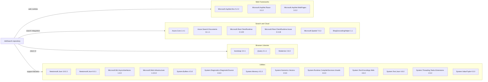

# Dependency Map

The two .NET projects declare 25 NuGet packages in their `packages.config` files. The legacy projects do not use central package management or checked-in dependency lock files.

## Dependencies

### Dependency Summary

| Category | Count | Key Libraries | Notes |
|---|---:|---|---|
| Web Frameworks | 3 | ASP.NET MVC, Razor, WebPages | Legacy ASP.NET MVC stack |
| Search and Cloud | 6 | Azure.Search.Documents, Azure.Core, Microsoft.Rest.ClientRuntime | Azure Search and spatial APIs |
| Browser Libraries | 3 | jQuery, Bootstrap, Modernizr | Front-end libraries, including vulnerable jQuery version |
| Utilities | 13 | Newtonsoft.Json, System.Text.Json, System.Memory | Framework support and JSON serialization |

### Version & Compatibility Risks

The projects target .NET Framework 4.7.2 and 4.5 and use older ASP.NET MVC and NuGet packages. The dependency assessment found vulnerable versions of Newtonsoft.Json, Microsoft.Rest.ClientRuntime, System.Text.Encodings.Web, and jQuery; see the security assessment for affected ranges and advisories.

### Notable Observations

- The projects declare different Newtonsoft.Json versions: 10.0.3 for the web application and 9.0.1 for DataLoader.
- `dotnet list package --include-transitive` could not resolve the legacy projects on this host, so this inventory reflects declared packages only; transitive packages are not available from a lock file.
- The web application declares both Newtonsoft.Json and System.Text.Json dependencies.
- No test-scoped dependencies are declared.

## Test Dependencies

| Framework | Version | Notes |
|---|---|---|
| None detected | — | No test dependencies or test projects are present in the repository. |

Total test-scope dependencies: 0
No test infrastructure was detected.
