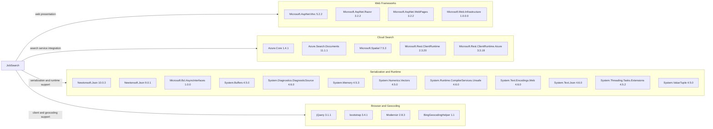

# Dependency Map

JobSearch declares 25 package references across its two projects, representing 24 distinct package IDs. The project files use legacy `packages.config` package management and do not declare test-scoped packages.

## Dependencies

### Dependency Summary

| Category | Count | Key Libraries | Notes |
|---|---:|---|---|
| Web Frameworks | 4 | ASP.NET MVC, Razor, WebPages, Web Infrastructure | Legacy ASP.NET MVC application |
| Cloud Search | 5 | Azure.Search.Documents, Azure.Core, Microsoft.Rest clients | Azure Cognitive Search integration |
| Serialization and Runtime | 12 | Newtonsoft.Json, System.Text.Json, System.Memory | Framework support packages and two Newtonsoft.Json versions across projects |
| Browser and Geocoding | 4 | jQuery, Bootstrap, Modernizr, BingGeocodingHelper | Includes older browser libraries |

### Version & Compatibility Risks

The web application targets .NET Framework 4.7.2 and the DataLoader targets .NET Framework 4.5. Both are legacy, non-SDK projects. Declared versions include Newtonsoft.Json 9.0.1 and 10.0.3, System.Text.Encodings.Web 4.6.0, ASP.NET MVC 5.2.2, and older browser dependencies. The dependency scan identified CVE-2024-21907 in both Newtonsoft.Json versions and CVE-2021-26701 in System.Text.Encodings.Web 4.6.0; see the security assessment in the versioned report.

### Notable Observations

- Newtonsoft.Json is declared at two different versions because it is referenced by both projects.
- The web application declares both System.Text.Json and Newtonsoft.Json packages.
- The package dependency CLI could not resolve these legacy `packages.config` projects in this environment, so this inventory lists direct declarations only.

## Test Dependencies

| Framework | Version | Notes |
|---|---|---|
| None detected | — | No test-scoped package references were found |

Total test-scope dependencies: 0

No test project or test dependencies were detected.
