# Dependency Map

The repository declares 25 NuGet package references across the MVC website and the console index loader. The legacy `packages.config` manifests provide direct package versions; transitive versions could not be resolved with the available .NET CLI.

## Dependencies

```mermaid
flowchart LR
    App["JobSearch application"]
    subgraph Web["Web Frameworks"]
        MVC["Microsoft.AspNet.Mvc 5.2.2"]
        Razor["Microsoft.AspNet.Razor 3.2.2"]
        Pages["Microsoft.AspNet.WebPages 3.2.2"]
    end
    subgraph Search["Search and Cloud SDK"]
        Core["Azure.Core 1.4.1"]
        AzureSearch["Azure.Search.Documents 11.1.1"]
        Spatial["Microsoft.Spatial 7.5.3"]
        Rest["Microsoft.Rest.ClientRuntime 2.3.20"]
        RestAzure["Microsoft.Rest.ClientRuntime.Azure 3.3.18"]
    end
    subgraph UI["Browser UI"]
        Bootstrap["bootstrap 3.4.1"]
        JQuery["jQuery 3.1.1"]
        Modernizr["Modernizr 2.8.3"]
    end
    subgraph Utility["Utilities and Compatibility"]
        Bing["BingGeocodingHelper 1.1"]
        Async["Microsoft.Bcl.AsyncInterfaces 1.0.0"]
        WebInfra["Microsoft.Web.Infrastructure 1.0.0.0"]
        NewtonsoftWeb["Newtonsoft.Json 10.0.3"]
        NewtonsoftLoader["Newtonsoft.Json 9.0.1"]
        Buffers["System.Buffers 4.5.0"]
        Diagnostics["System.Diagnostics.DiagnosticSource 4.6.0"]
        Memory["System.Memory 4.5.3"]
        Vectors["System.Numerics.Vectors 4.5.0"]
        Unsafe["System.Runtime.CompilerServices.Unsafe 4.6.0"]
        Encodings["System.Text.Encodings.Web 4.6.0"]
        TextJson["System.Text.Json 4.6.0"]
        Tasks["System.Threading.Tasks.Extensions 4.5.2"]
        Tuples["System.ValueTuple 4.5.0"]
    end
    App -->|"web framework"| Web
    App -->|"search integration"| Search
    App -->|"browser UI"| UI
    App -->|"support libraries"| Utility
```

### Dependency Summary

| Category | Count | Key Libraries | Notes |
|---|---:|---|---|
| Web Frameworks | 3 | ASP.NET MVC 5.2.2, Razor 3.2.2, WebPages 3.2.2 | Legacy ASP.NET MVC stack |
| Search and Cloud SDK | 5 | Azure.Search.Documents 11.1.1, Azure.Core 1.4.1 | Azure Search client and supporting REST/spatial libraries |
| Browser UI | 3 | Bootstrap 3.4.1, jQuery 3.1.1, Modernizr 2.8.3 | Browser-side UI dependencies |
| Utilities and Compatibility | 14 | Newtonsoft.Json 9.0.1 and 10.0.3; System.* compatibility packages | Includes one package used by the separate loader and numerous framework compatibility libraries |

### Version & Compatibility Risks

The projects target .NET Framework 4.7.2 and 4.5, respectively, and use older MVC and browser-library versions. Dependency scanning identified high-severity CVE-2024-21907 in both declared Newtonsoft.Json versions and critical CVE-2021-26701 in System.Text.Encodings.Web 4.6.0. Package compatibility for a net10.0 migration needs a project-format-aware assessment; the current legacy projects cannot be fully analyzed by AppCAT in this Linux environment.

### Notable Observations

- `Newtonsoft.Json` is declared at different versions in the website and loader.
- `packages.config` dependency resolution is unavailable through `dotnet list package`; the inventory therefore lists declared packages only.
- No test-scoped NuGet dependencies or test project were detected.

## Test Dependencies

| Framework | Version | Notes |
|---|---|---|
| None detected | — | No test-scoped packages are declared |

Total test-scope dependencies: 0

No test dependencies or test project were detected in the repository.
