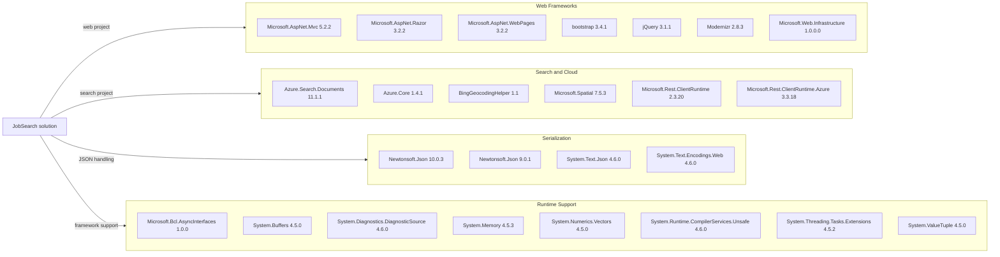

# Dependency Map

The repository contains two .NET Framework projects with 25 declared NuGet package entries across their `packages.config` files. The web application uses ASP.NET MVC and Azure AI Search; the console importer uses Newtonsoft.Json.

## Dependencies

### Dependency Summary

| Category | Count | Key Libraries | Notes |
|---|---:|---|---|
| Web Frameworks and UI | 7 | ASP.NET MVC 5.2.2, Razor 3.2.2, Bootstrap 3.4.1, jQuery 3.1.1 | Legacy ASP.NET MVC application and UI assets |
| Search and Cloud | 6 | Azure.Search.Documents 11.1.1, Azure.Core 1.4.1 | Search integration and legacy REST client support |
| Serialization | 4 | Newtonsoft.Json 10.0.3 and 9.0.1, System.Text.Json 4.6.0 | Multiple JSON libraries and two Newtonsoft.Json versions across projects |
| Runtime Support | 8 | System.Memory 4.5.3, System.Buffers 4.5.0 | Compatibility libraries referenced by the .NET Framework web project |

### Version & Compatibility Risks

Both projects target older .NET Framework versions (4.7.2 and 4.5), while the web stack includes ASP.NET MVC 5.2.2 and older front-end libraries. The importer targets .NET Framework 4.5 and uses Newtonsoft.Json 9.0.1. The application will require compatibility review and likely framework and package upgrades before moving to modern .NET.

### Notable Observations

- The web project and importer use different Newtonsoft.Json versions (10.0.3 and 9.0.1).
- The web project combines the modern Azure.Search.Documents client with older Microsoft REST client packages.
- The application includes multiple runtime support packages that are typically used to backfill newer APIs on .NET Framework.
- The package manifests declare dependencies but no test-scoped packages.

## Test Dependencies

| Framework | Version | Notes |
|---|---|---|
| None detected | — | No test-scoped NuGet dependencies are declared |

Total test-scope dependencies: 0

No test dependencies or test project were detected in the inspected project manifests.
