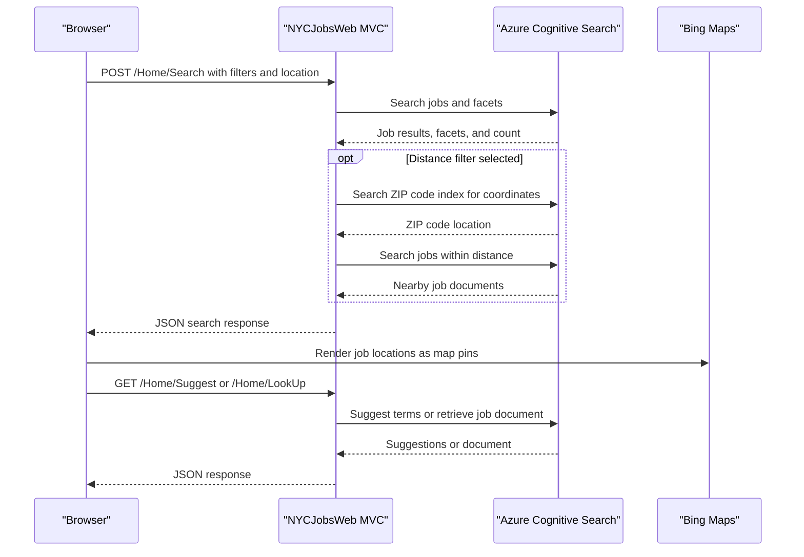

# API & Service Communication Contracts

The web application exposes five MVC actions for pages, search, suggestions, and job lookup; search-related actions return JSON synchronously. A separate console utility communicates with Azure Cognitive Search over HTTPS to provision sample indexes and documents.

## Service Catalog

| Service | Port | Category | Purpose |
|---|---|---|---|
| NYCJobsWeb | Configured by the hosting environment | API Layer | Serves MVC pages and JSON job-search actions |
| DataLoader | None; console process | Infrastructure utility | Deletes/recreates Azure Search indexes and imports local schema/JSON data |
| Azure Cognitive Search | External managed endpoint | Infrastructure | Stores searchable job and ZIP-code documents |
| Bing Maps JavaScript API | External managed endpoint | Infrastructure | Displays map pins in the browser |

## API Endpoints Inventory

The default MVC route is `/{controller}/{action}/{id}`. The action paths below use the default `Home` controller prefix.

| Service | Method | Path | Request Type | Response Type |
|---|---|---|---|---|
| NYCJobsWeb | GET | `/Home/Index` | None | HTML search page |
| NYCJobsWeb | GET | `/Home/JobDetails` | None | HTML job details page |
| NYCJobsWeb | POST (also accepts default MVC verbs) | `/Home/Search` | Query/form values: search text, facet values, sorting, coordinates, page, ZIP, distance | JSON `NYCJob` with search results, facets, and count |
| NYCJobsWeb | GET | `/Home/Suggest` | Query: `term`, optional `fuzzy` | JSON array of suggestion strings |
| NYCJobsWeb | GET | `/Home/LookUp?id={id}` | Query/path identifier `id` | JSON `NYCJobLookup` wrapping a search document |

No URL or header API-versioning scheme is present. `Suggest` is explicitly GET-only; `Search` is called by the UI with POST and has no verb restriction attribute. `LookUp` returns no result when `id` is null.

## Management & Observability Endpoints

| Service | Endpoint | Custom Metrics |
|---|---|---|
| NYCJobsWeb | None detected | None detected |
| DataLoader | Console process only | None detected |

No health-check, metrics, or Swagger endpoints were identified.

## DTOs & Contracts

`NYCJob` is the web search response model, `NYCJobLookup` is the single-document lookup response model, and Azure SDK `SearchDocument`/`SearchResult` types carry indexed data. These mutable C# classes expose public setters. Search and suggestion inputs are ordinary MVC query/form parameters rather than dedicated request DTOs. No OpenAPI, protobuf, or GraphQL contract was found. The DataLoader uses Newtonsoft.Json serialization for its REST request helper.

## Communication Patterns

The browser calls MVC actions synchronously over HTTP. The controller delegates to `JobsSearch`, which makes synchronous SDK calls to Azure Cognitive Search for jobs, ZIP-code geocoding, suggestions, and document lookup. The DataLoader uses synchronous `HttpClient.SendAsync(...).Result` REST calls over an explicitly constructed HTTPS service URI. No message broker, service discovery, API gateway, client-side load balancing, timeout policy, retry policy, circuit breaker, or configured fallback was found. No authentication or authorization is implemented for the MVC actions; Azure Search credentials are configured separately, while a map credential is embedded in client code. No TLS configuration for the web host is evidenced in the repository.

## Service Technology Matrix

| Service | Web | Data Access | Discovery | Gateway | Health | Cache | Metrics |
|---|---|---|---|---|---|---|---|
| NYCJobsWeb | ASP.NET MVC 5 | Azure Search SDK | None | None | None | None | None |
| DataLoader | Console | Azure Search REST API | None | None | None | None | None |

## Service Communication Sequence

