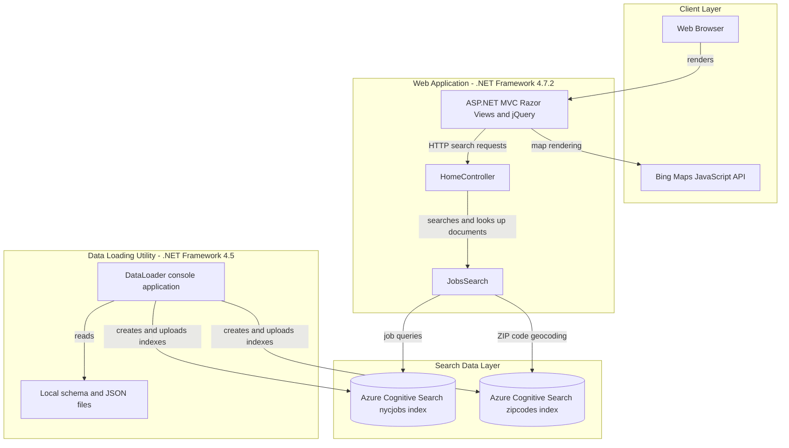
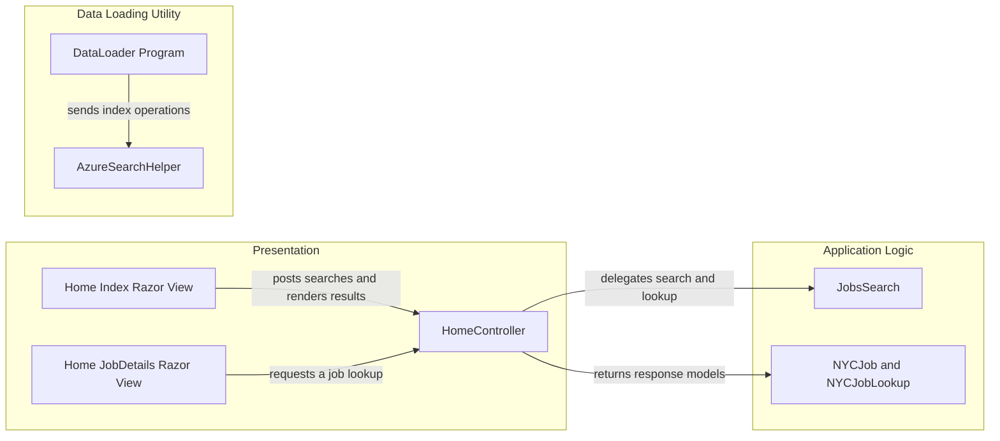

# Architecture Diagram

JobSearch contains a browser-facing job search site and a separate console utility for loading sample data. Both use Azure Cognitive Search indexes; the web experience also relies on the Bing Maps JavaScript control for location display.

## Application Architecture

### Technology Stack Summary

| Layer | Technology | Version | Purpose |
|---|---|---:|---|
| Presentation | ASP.NET MVC and Razor | MVC 5.2.2 | Serves job search pages and JSON actions |
| Business logic | C# on .NET Framework | 4.7.2 | Handles search, facets, geospatial filtering, and lookup |
| Search access | Azure.Search.Documents | 11.1.1 | Queries Azure Cognitive Search indexes |
| Data loading | C# console application on .NET Framework | 4.5 | Recreates indexes and uploads sample documents |
| Mapping | Bing Maps JavaScript API | External service | Displays map pins for job locations |
| Browser libraries | jQuery, Bootstrap | 3.1.1, 3.4.1 | Browser interactions and presentation |

### Data Storage & External Services

The application has no relational database or local persistence layer. Azure Cognitive Search stores job postings and ZIP-code geospatial documents in separate indexes. The DataLoader utility seeds those indexes from schema and JSON files in the web project. The browser calls Bing Maps to visualize search results.

### Key Architectural Decisions

- Search and geospatial lookup are implemented directly through Azure Cognitive Search; no repository or ORM layer is present.
- Job search and the sample-data loader are separate projects and are deployed/run independently.
- The web client composes search responses into HTML and map pins in the browser.

## Component Relationships

### Component Inventory

| Component | Layer | Type | Responsibility |
|---|---|---|---|
| Home Index Razor View | Presentation | Razor view and JavaScript | Collects search criteria, displays facets/results, and renders map pins |
| Home JobDetails Razor View | Presentation | Razor view and JavaScript | Requests and displays a selected job document |
| HomeController | Presentation | ASP.NET MVC controller | Exposes page actions and JSON search, suggestion, and lookup actions |
| JobsSearch | Application Logic | Search client wrapper | Queries job and ZIP-code search indexes, facets, suggestions, and documents |
| NYCJob | Application Logic | Response model | Holds search results, facets, and count |
| NYCJobLookup | Application Logic | Response model | Holds one looked-up search document |
| DataLoader Program | Data Loading Utility | Console entry point | Recreates indexes and uploads sample JSON documents |
| AzureSearchHelper | Data Loading Utility | HTTP and JSON helper | Sends REST requests and serializes JSON for index operations |
