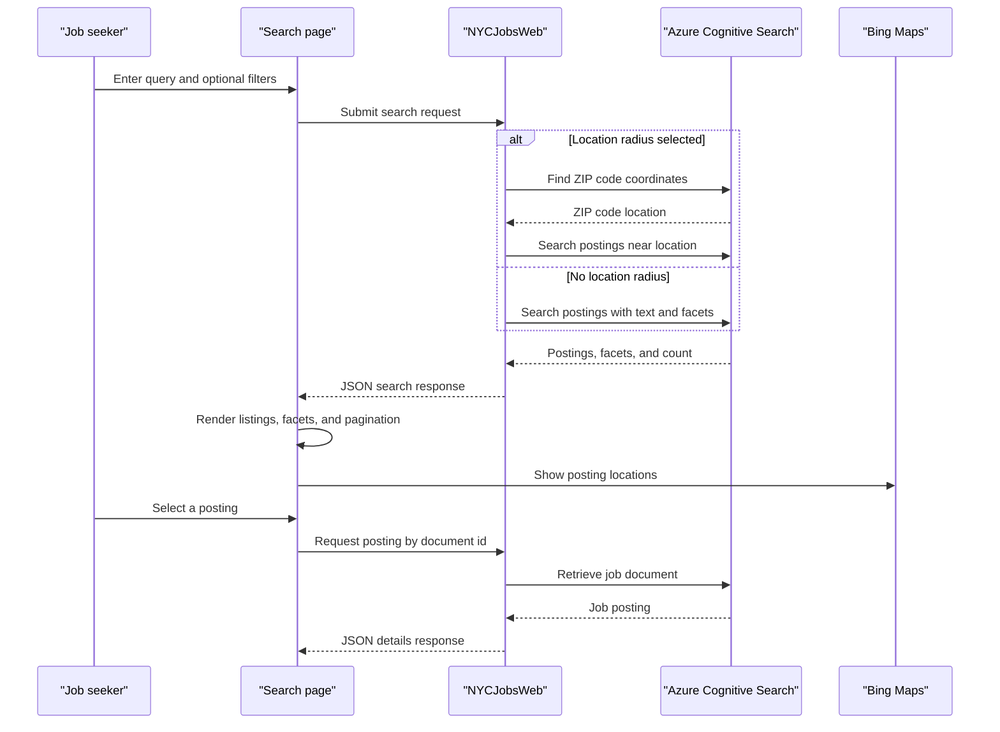

# Core Business Workflows

JobSearch helps people discover New York City job postings by keyword, job attributes, and location, and lets them inspect an individual posting. A companion console utility refreshes the search indexes from bundled sample data.

## Domain Entities

| Entity | Service / Bounded Context | Description | Key Relationships |
|---|---|---|---|
| Job posting | NYCJobsWeb / Job Discovery | Public listing describing an available city job and its posting details | Has a geospatial location used for map display and distance filtering |
| ZIP-code document | NYCJobsWeb / Location Search | ZIP code and geographic coordinates used to resolve a search origin | Supplies a coordinate to nearby job searches; stored in a separate search index |
| Search result | NYCJobsWeb / Job Discovery | A job posting returned with facets and result count | Groups postings with facets and pagination metadata |

## Service-to-Domain Mapping

| Service | Domain Context | Owned Entities | External Dependencies |
|---|---|---|---|
| NYCJobsWeb | Job Discovery and Location Search | Reads job postings and ZIP-code documents; no write ownership | Azure Cognitive Search, Bing Maps |
| DataLoader | Search Index Provisioning | Creates and populates job and ZIP-code indexes | Azure Cognitive Search and repository sample data |

The search indexes are the source of truth for the demo's searchable records. DataLoader is a separate operational utility that replaces index content; no domain data is exchanged between the two projects except through the shared indexes and static files.

## Primary Workflows

### Workflow 1: Search and filter job postings

1. A visitor enters a keyword or accepts the default all-jobs search, then optionally selects facets, sorting, pagination, or a location radius.
2. The browser posts criteria to the MVC search action.
3. The application converts a blank keyword to a wildcard search. When distance is requested, it first looks up the ZIP-code document to obtain coordinates.
4. The search layer queries the job index with selected facets/sort order and optional geospatial filtering.
5. The response returns documents, available facets, and a result count; the browser displays listings, facets, pages, and map pins.

### Workflow 2: Inspect or find a job title

The visitor opens a job detail view, which requests a document by identifier. As the visitor types, the suggestion action requests fuzzy or exact suggestions from the search service and returns suggestion text to the browser.

### Workflow 3: Refresh sample search indexes

An operator runs DataLoader with target service settings. The utility deletes and recreates the ZIP-code and job indexes using local schema files, then uploads matching JSON files. Errors are printed to the console; the operation is destructive to existing index contents.

## Cross-Service Data Flows

NYCJobsWeb first obtains ZIP-code coordinates from the `zipcodes` index when a radius search is enabled, then uses the location in a geospatial filter against the `nycjobs` index. Job results are returned as search documents and rendered in a browser map. DataLoader accesses the same indexes directly to replace and repopulate their contents. These are shared external search resources rather than inter-service HTTP calls; no circuit breaker or fallback response is implemented.

## Business Workflow Sequence

## Business Rules & Decision Logic

- Blank search text becomes a wildcard, allowing the visitor to browse all indexed jobs.
- Optional business-title, posting-type, salary, and geographic criteria are combined into a search filter.
- The location workflow only looks up a ZIP code when maximum distance is positive; the resulting coordinates determine the proximity filter.
- Results use ten records per page and may be sorted by featured score, salary, or posting date.
- Suggestions can use fuzzy matching; duplicate suggestion strings are removed before responding.
- No user accounts, eligibility checks, payment flows, authorization rules, transaction boundaries, audit trail, or explicit business-level input validation are present.
