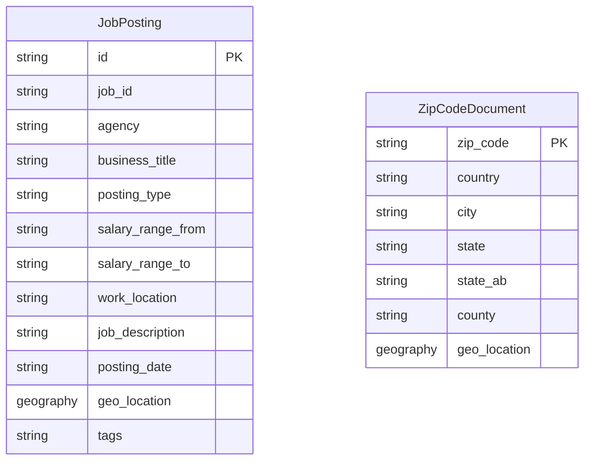

# Data Architecture & Persistence Layer

The data layer consists of two Azure Cognitive Search indexes for job-posting documents and ZIP-code/geospatial documents; there is no relational database or ORM entity layer. The application queries those indexes directly, while the DataLoader imports schema definitions and sample JSON files.

## Database Configuration

| Service/Module | DB Type | Profile | Driver | Connection | Migration Tool |
|---|---|---|---|---|---|
| NYCJobsWeb | Azure Cognitive Search | Single configured service | Azure.Search.Documents 11.1.1 | Search endpoint and API key are intended to come from application settings; current configuration does not provide a populated key | None; index schema files are provisioned by the DataLoader |
| DataLoader | Azure Cognitive Search | Target service from App.config | HttpClient and Newtonsoft.Json | HTTPS endpoint derived from the target service name; API key supplied through configuration | None; indexes are deleted/recreated and loaded from schema/JSON files |

## Data Ownership per Service

| Service | Tables Owned | ORM Framework | Caching | Notes |
|---|---|---|---|---|
| NYCJobsWeb | `nycjobs` and `zipcodes` search indexes are read | None | None | Queries indexes using Azure Search SDK; does not own relational tables |
| DataLoader | `nycjobs` and `zipcodes` search indexes are written | None | None | Owns the sample-index provisioning/import workflow |

## Entity Model

The entities above are document shapes stored in separate search indexes rather than relational tables. The application looks up a ZIP-code document to obtain coordinates for distance filtering; no stored foreign-key relationship exists between ZIP-code and job documents. `NYCJob` and `NYCJobLookup` are API response models, not persisted entities. No transaction management or ORM relationships were found.

## Key Repository Methods

| Service | Repository | Notable Methods | Purpose |
|---|---|---|---|
| NYCJobsWeb | `JobsSearch` | `Search`, `SearchZip`, `Suggest`, `LookUp` | Executes search, ZIP lookup, autocomplete, and single-document retrieval through Azure SDK clients |
| DataLoader | `AzureSearchHelper` | `SendSearchRequest`, `SerializeJson`, `DeserializeJson` | Makes REST requests and serializes JSON for index provisioning and document uploads |

No repository interfaces, custom SQL queries, or ORM methods are present.

## Caching Strategy

No cache provider, cache annotations, in-memory cache, or distributed cache configuration was found. Search requests are sent to Azure Cognitive Search directly.

## Data Ownership Boundaries

The web application and DataLoader access the same two Azure Search indexes but serve different roles: the web application reads documents, and the utility creates/replaces indexes and imports sample data. They share the schema and sample data files in the repository; no cross-service database joins or event-driven data exchange are present. Search results and ZIP-code coordinates are composed in the web search flow, with the ZIP-code lookup used to calculate a geographic filter for the job index.

### Data Classification & Sensitivity

| Entity | Sensitive Fields | Classification (PII/PHI/PCI/None) | Controls in Place |
|---|---|---|---|
| JobPosting | `recruitment_contact`, `to_apply` may contain contact details | Potential PII | No field-level access controls or masking are evident; records represent public job postings |
| ZipCodeDocument | ZIP code and geographic location | None / coarse location data | No field-level controls are evident |

No PHI or PCI fields were identified in the indexed data model.
