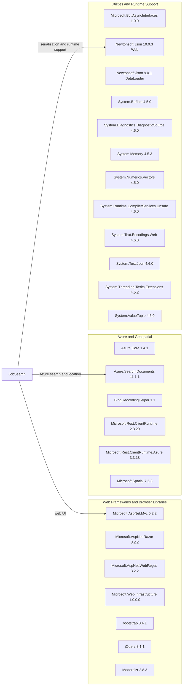

# Dependency Map

JobSearch declares 25 package references across the web application and data-loading utility. The map groups each declared package by functional role; framework assemblies supplied by .NET are not counted as NuGet packages.

## Dependencies

### Dependency Summary

| Category | Count | Key Libraries | Notes |
|---|---:|---|---|
| Web Frameworks and Browser Libraries | 7 | ASP.NET MVC 5.2.2, Razor 3.2.2, jQuery 3.1.1, Bootstrap 3.4.1 | Legacy ASP.NET MVC stack and browser assets |
| Azure and Geospatial | 6 | Azure.Search.Documents 11.1.1, Azure.Core 1.4.1, Microsoft.Spatial 7.5.3 | Search service and geospatial queries; legacy REST client packages also declared |
| Utilities and Runtime Support | 12 | Newtonsoft.Json 9.0.1 and 10.0.3, System.Text.Json 4.6.0 | Includes framework-support libraries and two versions of Newtonsoft.Json |
| **Total** | **25** |  | 24 web packages and one DataLoader package reference |

### Version & Compatibility Risks

Both projects target .NET Framework rather than modern .NET. Several packages are old; the declared Newtonsoft.Json 9.0.1/10.0.3 versions and System.Text.Encodings.Web 4.6.0 are affected by advisories recorded in the accompanying security assessment. The web application also uses ASP.NET MVC 5, which requires a migration path rather than a direct ASP.NET Core package update.

### Notable Observations

- Newtonsoft.Json is independently declared at two versions across the two projects.
- The browser stack includes jQuery 3.1.1 and Bootstrap 3.4.1.
- The web application references both Azure SDK packages and older Microsoft REST client libraries.

## Test Dependencies

| Framework | Version | Notes |
|---|---|---|
| None detected | — | No test-scoped packages or test projects are declared in the solutions. |

Total test-scope dependencies: 0

No test dependencies detected; no automated test project is included in either solution.
