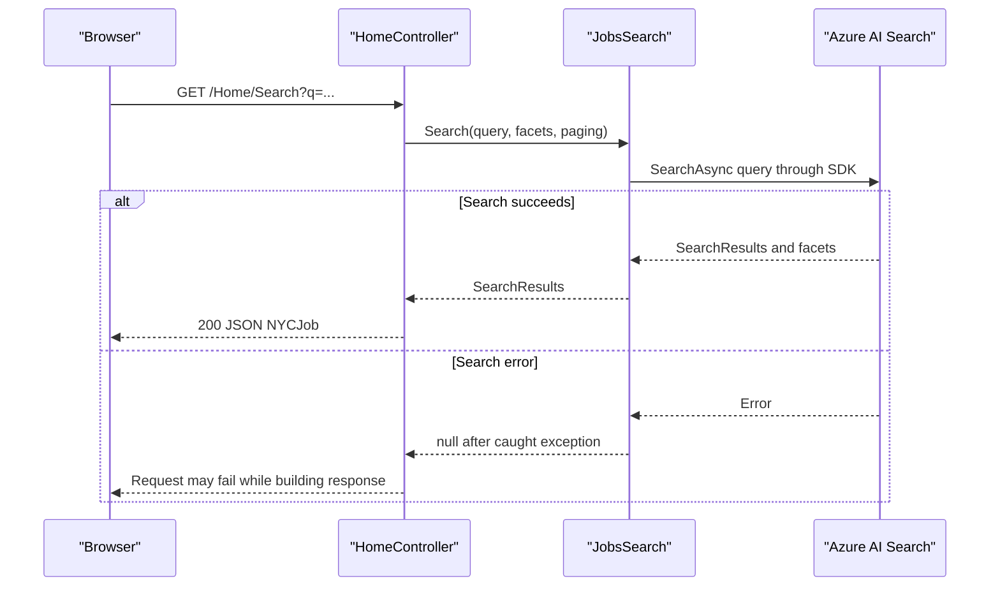

# API & Service Communication Contracts

JobSearch exposes four MVC action routes for page rendering and JSON search operations. Communication is synchronous: browser requests are handled by the web project, which calls Azure AI Search directly; a separate console utility sends REST requests to the same service.

## Service Catalog

| Service | Port | Category | Purpose |
|---|---|---|---|
| NYCJobsWeb | Not specified | API Layer | Renders job-search pages and serves search, suggestion, and lookup actions |
| DataLoader | Not applicable | Business | Console utility that creates search indexes and uploads JSON documents |
| Azure AI Search | HTTPS 443 | Infrastructure | Stores job and ZIP-code indexes and supports search operations |

## API Endpoints Inventory

| Service | Method | Path | Request Type | Response Type |
|---|---|---|---|---|
| NYCJobsWeb | GET | `/Home/Index` (also default `/`) | None | MVC view |
| NYCJobsWeb | GET | `/Home/JobDetails` | None | MVC view |
| NYCJobsWeb | GET | `/Home/Search` | Query parameters for search text, facets, sorting, location, and paging | JSON `NYCJob` |
| NYCJobsWeb | GET | `/Home/Suggest` | Query parameters `term` and optional `fuzzy` | JSON list of strings |
| NYCJobsWeb | GET | `/Home/LookUp/{id}` | Route parameter `id` | JSON `NYCJobLookup` |
| DataLoader to Azure AI Search | DELETE | `/indexes/{indexName}` | HTTP request to delete an index | HTTP response |
| DataLoader to Azure AI Search | POST | `/indexes` | Index schema JSON | HTTP response |
| DataLoader to Azure AI Search | POST | `/indexes/{indexName}/docs/index` | Document batch JSON | HTTP response |

The MVC routes use the default `{controller}/{action}/{id}` routing pattern. No API versioning scheme is defined.

## Management & Observability Endpoints

| Service | Endpoint | Custom Metrics (if any) |
|---|---|---|
| NYCJobsWeb | None identified | None identified |
| DataLoader | None; console application | None identified |

## DTOs & Contracts

`NYCJob` is the search response wrapper containing results, facets, and a count; `NYCJobLookup` wraps a single Azure Search document for lookup responses. These are mutable C# classes, not immutable records. Search and lookup result content uses Azure Search SDK model types. The DataLoader serializes and deserializes JSON through Newtonsoft.Json. No OpenAPI/Swagger, protobuf, or GraphQL contract was found.

## Communication Patterns

Browser-to-web and web-to-Azure Search calls are synchronous. The web application uses the Azure Search .NET SDK; the separate DataLoader uses `HttpClient` and the Azure Search REST API over HTTPS. No message broker, service discovery, API gateway, client-side load balancing, retry policy, circuit breaker, bulkhead, or explicit timeout configuration was identified. Search exceptions are caught by the search wrapper and return `null`; callers do not have a defined fallback response.

No API authentication, authorization checks, or TLS enforcement are configured for the MVC endpoints in the application code. The DataLoader and web project use API keys for their outbound Azure Search requests, and the loader constructs an HTTPS service URI.

## Service Technology Matrix

| Service | Web | Data Access | Discovery | Gateway | Actuator | Cache | Metrics |
|---|---|---|---|---|---|---|---|
| NYCJobsWeb | ASP.NET MVC 5 | Azure Search SDK | None | None | None | None identified | None identified |
| DataLoader | Console application | Azure Search REST API | None | None | None | None | None |
| Azure AI Search | Managed search service | Search indexes | Azure endpoint configuration | None | Managed service | Not identified | Not identified |

## Service Communication Sequence

