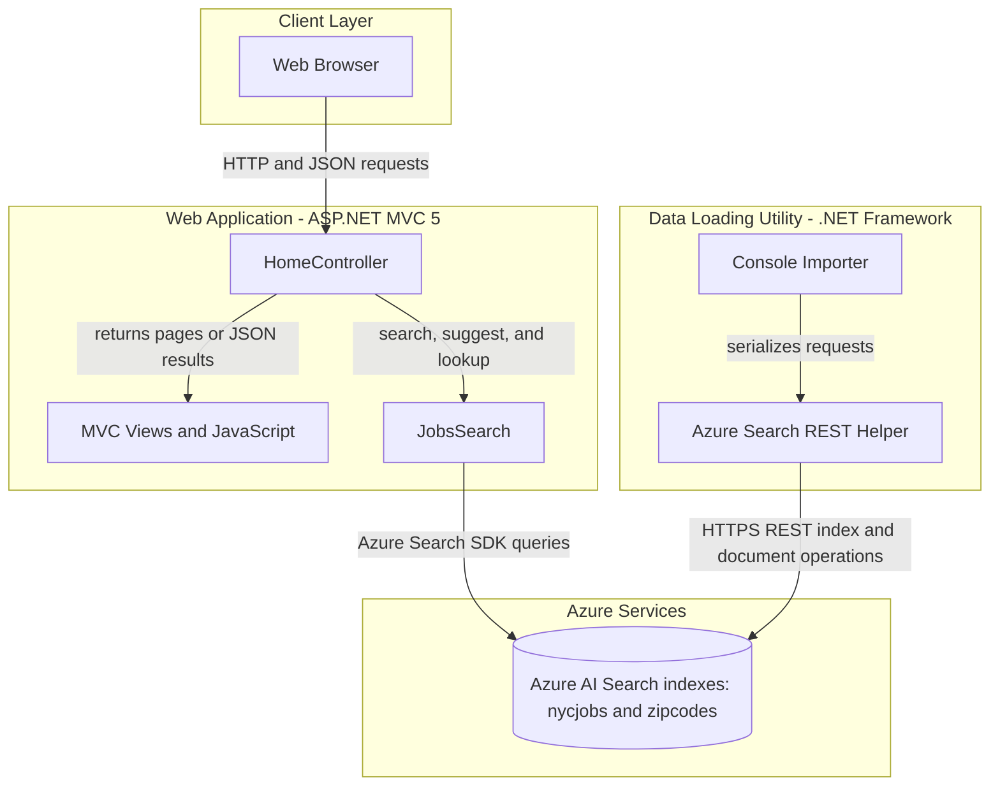
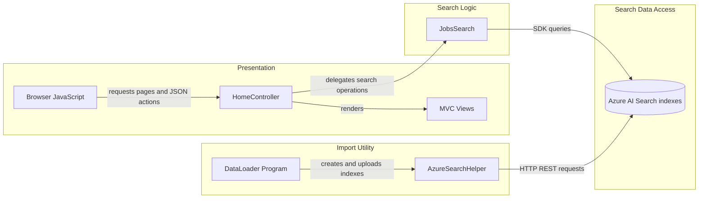

# Architecture Diagram

JobSearch consists of an ASP.NET MVC web application for searching NYC job postings and a separate console utility for loading JSON data into Azure Search.

## Application Architecture

### Technology Stack Summary

| Layer | Technology | Version | Purpose |
|---|---|---|---|
| Presentation | ASP.NET MVC | 5.2.2 | Serves job-search pages and JSON endpoints |
| Search integration | Azure.Search.Documents | 11.1.1 | Queries job and ZIP-code indexes |
| Data loading | .NET Framework console application | 4.5 | Creates indexes and uploads JSON documents |
| REST serialization | Newtonsoft.Json | 9.0.1 | Serializes and deserializes data-loader requests |
| Cloud search | Azure AI Search | Configured externally | Stores and searches job postings and ZIP codes |

### Data Storage & External Services

The application uses two Azure AI Search indexes, `nycjobs` and `zipcodes`, for its searchable data. The web application queries them through the Azure Search .NET SDK; the separate loader creates indexes and uploads schema and JSON files through the Azure Search REST API. No relational database or cache is configured. A Bing geocoding helper package and Bing key setting are present, but no geocoding call was identified in the application source.

### Key Architectural Decisions

- The MVC web application and the data import utility are separate projects with distinct responsibilities.
- Job searches, suggestions, and record lookups are served as JSON actions and backed by Azure AI Search.
- Azure Search endpoint and credentials are configured in application settings rather than supplied through dependency injection.

## Component Relationships

### Component Inventory

| Component | Layer | Type | Responsibility |
|---|---|---|---|
| Browser JavaScript | Presentation | Client-side scripts | Calls search and detail endpoints and renders results |
| HomeController | Presentation | ASP.NET MVC controller | Serves pages and JSON actions for search, suggestions, and job lookup |
| MVC Views | Presentation | Razor views | Renders the search and job-detail pages |
| JobsSearch | Search Logic | Search client wrapper | Queries the job and ZIP-code indexes |
| DataLoader Program | Import Utility | Console entry point | Creates indexes and uploads sample data |
| AzureSearchHelper | Import Utility | REST helper | Adds API-version query parameters and serializes REST payloads |
| Azure AI Search indexes | Search Data Access | Cloud search service | Stores searchable job postings and ZIP-code records |
