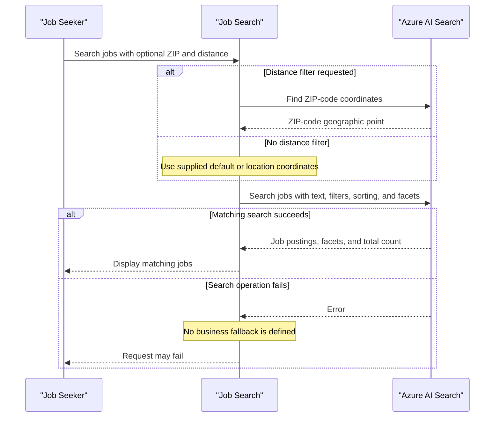

# Core Business Workflows

JobSearch helps users discover New York City job postings by keyword, category, salary, recency, and location. A separate utility provisions the search indexes and loads the job and ZIP-code reference data used by the web experience.

## Domain Entities

| Entity | Service / Bounded Context | Description | Key Relationships |
|---|---|---|---|
| JobPosting | NYCJobsWeb / Job Search | A public-sector job announcement displayed to job seekers | Uses location data for distance-based search; no stored relationship to a ZIP-code record is declared |
| ZipCode | NYCJobsWeb / Location Search | Geographic reference record used to resolve a ZIP code to a point | Provides a location point for distance filtering; no relational key is declared |

## Service-to-Domain Mapping

| Service | Domain Context | Owned Entities | External Dependencies |
|---|---|---|---|
| NYCJobsWeb | Job Search and Location Search | No local persistence; reads job and ZIP-code search documents | Azure AI Search |
| DataLoader | Search Data Provisioning | No local persistence; provisions and uploads source records | Azure AI Search REST API and repository schema/data files |

## Primary Workflows

### Workflow 1: Search job postings

1. A user submits search text and optional title, posting-type, salary, sort, page, and location criteria.
2. If search text is blank, the web action searches for all postings using `*`.
3. The search component builds query options, requested fields, facets, and any supported sorting or filters.
4. Azure AI Search returns matching postings, facets, and the total count; the web application returns them in a search response.
5. When a distance limit is requested, the application first looks up the ZIP-code document and uses its coordinates for a geographic filter.

### Workflow 2: Suggest search terms and retrieve a job

The suggestion action sends the supplied term to the job index and returns unique suggested terms. The job lookup action retrieves a document by its identifier and wraps it in the lookup response. Both flows depend on the matching document being available in Azure AI Search.

### Workflow 3: Load search data

The console utility processes the `zipcodes` and `nycjobs` indexes in sequence. For each, it attempts to delete the index, creates it from the corresponding schema file, and uploads matching JSON files. This import flow is an explicit data mutation, not a continuous synchronization process.

## Cross-Service Data Flows

The web application reads search data from the Azure AI Search service, while the independent loader provisions and writes to the same service. Job and ZIP-code results are not joined through a relational key: for distance searches the web application performs a ZIP-code lookup, extracts its geographic point, and supplies that point in a subsequent job search. No circuit breaker or fallback data source was identified; if search fails, the search wrapper returns `null` and the controller may fail while constructing its response.

## Business Workflow Sequence

## Business Rules & Decision Logic

- A blank keyword is treated as a wildcard search for all jobs.
- Distance filtering is applied only when the requested maximum distance is positive; the ZIP-code index is queried to derive the center point.
- Search supports title and posting-type facets, salary range filtering, featured scoring, salary ordering, and most-recent ordering.
- Results are requested in pages of ten and include facets and a total count.
- Suggestions are deduplicated before being returned.
- The loader's index workflow deletes an existing index before recreating it and uploading data; there is no identified transaction, rollback, or compensating action.
- No explicit request validation framework, role-based authorization, business audit trail, or application transaction boundary was identified.
