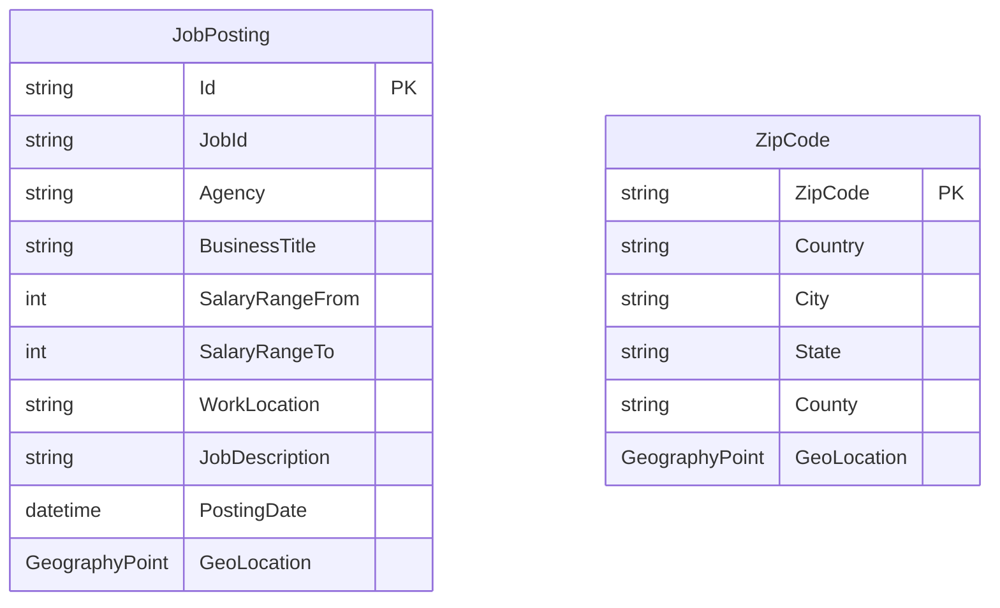

# Data Architecture & Persistence Layer

JobSearch persists search documents in two Azure AI Search indexes and has no relational ORM or local database configuration. Its application model classes wrap SDK search results rather than defining database entities.

## Database Configuration

| Service/Module | DB Type | Profile | Driver | Connection | Migration Tool |
|---|---|---|---|---|---|
| NYCJobsWeb | Azure AI Search | No profiles identified | Azure Search .NET SDK | Configured application endpoint and API key | None identified |
| DataLoader | Azure AI Search | No profiles identified | `HttpClient` and Azure Search REST API | Configured service name and API key; HTTPS | Index schema JSON and programmatic index creation |

No relational database, connection pool, ORM, schema migration framework, or seed SQL scripts were identified. Search index definitions and sample JSON documents are stored in `NYCJobsWeb/Schema_and_Data/`.

## Data Ownership per Service

| Service | Tables Owned | ORM Framework | Caching | Notes |
|---|---|---|---|---|
| NYCJobsWeb | None; reads `nycjobs` and `zipcodes` indexes | None | None identified | Search client wraps result documents in response models |
| DataLoader | None; provisions and populates both indexes | None | None | Uses schema and JSON files to create indexes and upload documents |
| Azure AI Search | `nycjobs` and `zipcodes` search indexes | Managed search index | Service-managed; application cache not identified | Searchable data persists outside the application |

## Entity Model

The only persistent models identified are the remote Azure Search indexes described by the schema files. `NYCJob` and `NYCJobLookup` in `NYCJobsWeb/Models/Jobs.cs` are API response wrappers, not persistence entities. No foreign-key or other index relationship is declared.

## Key Repository Methods

| Service | Repository | Notable Methods | Purpose |
|---|---|---|---|
| NYCJobsWeb | `JobsSearch` (`NYCJobsWeb/JobsSearch.cs`) | `Search`, `SearchZip`, `Suggest`, `LookUp` | Queries job records, resolves ZIP-code locations, suggests search terms, and retrieves a job document; no repository abstraction is present |
| DataLoader | None | `CreateTargetIndex`, `ImportFromJSON`, `DeleteIndex` (`DataLoader/DataLoader/Program.cs`) | Creates index definitions, uploads JSON documents, and deletes existing indexes using REST calls |

## Caching Strategy

No application-level cache provider, cache configuration, cache annotations, or cache-aside strategy was identified. Search responses are retrieved directly from Azure AI Search.

## Data Ownership Boundaries

The web application and loader access the same Azure AI Search service but have distinct read and write responsibilities: the web application queries the `nycjobs` and `zipcodes` indexes, while the loader creates the indexes and uploads documents. The index definitions are separate and declare no relationship; no cross-service database access or CQRS framework was identified.

### Data Classification & Sensitivity

| Entity | Sensitive Fields | Classification (PII/PHI/PCI/None) | Controls in Place |
|---|---|---|---|
| JobPosting | `recruitment_contact`, `to_apply` may contain contact details | Potential PII | No encryption-at-rest, masking, or field-level controls are configured in the application |
| ZipCode | ZIP code and geographic location | Location data; not directly identified as PII in the schema | No application-level encryption or masking identified |

