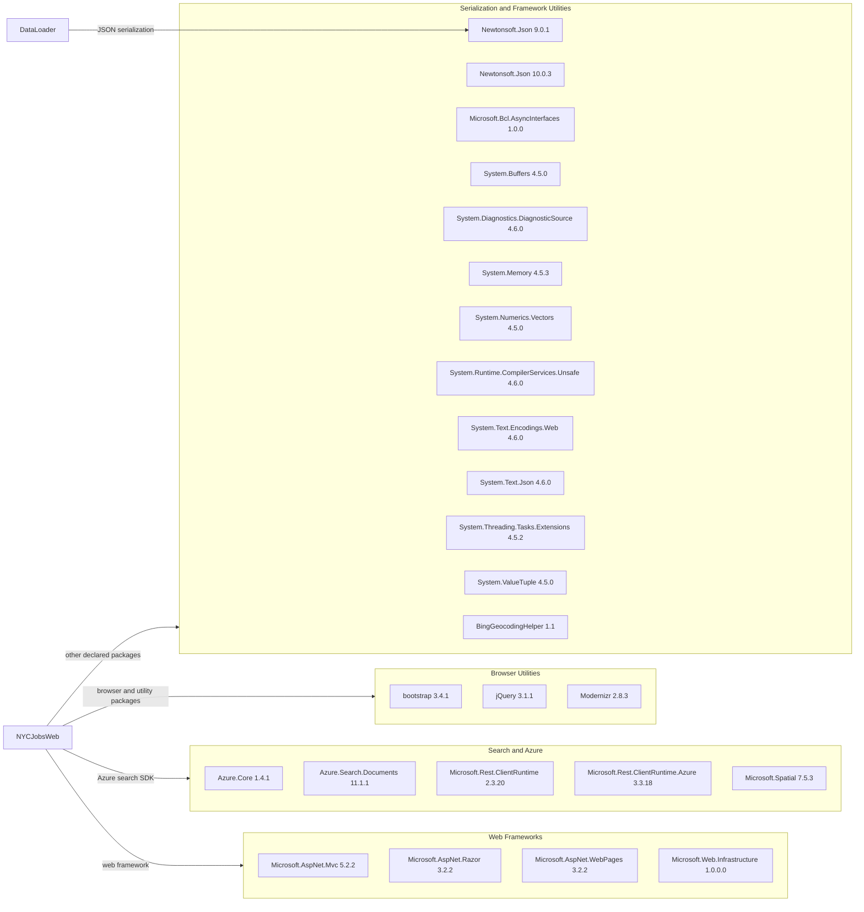

# Dependency Map

JobSearch contains two legacy .NET Framework projects with 25 declared NuGet package entries across their `packages.config` files. The map summarizes those direct dependencies by project and functional category.

## Dependencies

### Dependency Summary

| Category | Count | Key Libraries | Notes |
|---|---:|---|---|
| Web Frameworks | 4 | ASP.NET MVC 5.2.2, Razor 3.2.2, WebPages 3.2.2 | Legacy ASP.NET MVC stack targeting .NET Framework |
| Search and Azure | 5 | Azure.Search.Documents 11.1.1, Azure.Core 1.4.1 | Used by the web application's Azure Search integration |
| Browser Utilities | 3 | Bootstrap 3.4.1, jQuery 3.1.1 | Older client-side presentation dependencies |
| Serialization and Framework Utilities | 13 | Newtonsoft.Json 10.0.3/9.0.1, System.Text.Json 4.6.0 | Includes framework compatibility packages and the data-loader JSON dependency |

### Version & Compatibility Risks

Both projects target .NET Framework 4.5 or 4.7.2, and the package manifests contain older releases of ASP.NET MVC, jQuery, Newtonsoft.Json, and Azure libraries. These versions may present compatibility and support concerns when upgrading to modern .NET; the projects also use legacy `packages.config` dependency management.

### Notable Observations

- The solution pins two different Newtonsoft.Json versions: 10.0.3 in the web project and 9.0.1 in the loader.
- The web project references Azure SDK and legacy Microsoft REST client packages together.
- Several `System.*` packages support compatibility with the older target frameworks.
- BingGeocodingHelper is declared by the web project, while its use is not evident from package metadata alone.

## Test Dependencies

| Framework | Version | Notes |
|---|---|---|
| None detected | — | No test-scoped packages are declared in either `packages.config` |

Total test-scope dependencies: 0

No test dependencies detected in the available package manifests.
