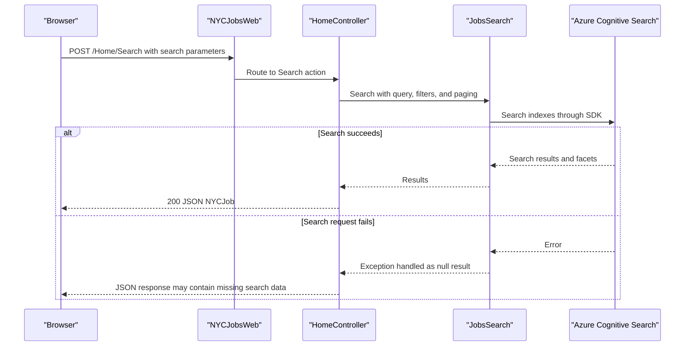

# API & Service Communication Contracts

The web application exposes three JSON actions and two page routes through the default MVC route. Browser-to-web calls and web-to-search calls are synchronous request/response interactions; a separate console utility communicates with the search service over REST.

## Service Catalog

| Service | Port | Category | Purpose |
|---|---|---|---|
| NYCJobsWeb | 51269 (IIS Express development setting; deployment port not specified) | API Layer | Serves job search pages and JSON actions |
| AzureSearchBackupRestore | Not applicable | Infrastructure | Console utility that provisions indexes and uploads sample documents |
| Azure Cognitive Search | External endpoint | Infrastructure | Stores and searches job postings and ZIP-code documents |

## API Endpoints Inventory

| Service | Method | Path | Request Type | Response Type |
|---|---|---|---|---|
| NYCJobsWeb | GET | `/Home/Index` (default `/`) | None | HTML view |
| NYCJobsWeb | GET | `/Home/JobDetails` | None | HTML view |
| NYCJobsWeb | POST | `/Home/Search` | Query/form parameters for search text, facets, sort, location, and paging | JSON `NYCJob` containing Search SDK results, facets, and count |
| NYCJobsWeb | GET | `/Home/Suggest` | Query parameters `term` and optional `fuzzy` | JSON array of suggestion strings |
| NYCJobsWeb | POST | `/Home/LookUp` | Form parameter `id` | JSON `NYCJobLookup` containing a search document; null if ID is absent |

The application uses the default `{controller}/{action}/{id}` route and does not declare an API versioning scheme. MVC route matching is case-insensitive.

## Management & Observability Endpoints

| Service | Endpoint | Custom Metrics |
|---|---|---|
| NYCJobsWeb | None identified | None identified |
| AzureSearchBackupRestore | None; console utility | None |

## DTOs & Contracts

`NYCJob` is the composite response returned by the search action; it combines search results, facets, and a count. `NYCJobLookup` wraps a single `SearchDocument` for the lookup response. Search and suggestion responses use Azure Search SDK result types. No dedicated request DTOs, immutable DTOs, OpenAPI/Swagger definitions, protobuf schemas, or GraphQL schemas were found. JSON is used for web responses; the data loader uses Newtonsoft.Json with camel-case property names and UTC date handling.

## Communication Patterns

The browser invokes MVC actions over HTTP; the web application calls Azure Cognitive Search synchronously through its SDK. The console utility uses synchronous REST calls through `HttpClient` and posts schema and document JSON. The web application also references a Bing geocoding helper. No message broker, service discovery, API gateway, retry policy, circuit breaker, or explicit timeout policy was identified. No authentication, authorization, or TLS enforcement is configured at the API level in the inspected application configuration; endpoints have no authorization attributes and are publicly reachable subject to hosting/network configuration.

## Service Technology Matrix

| Service | Web | Data Access | Discovery | Gateway | Actuator | Cache | Metrics |
|---|---|---|---|---|---|---|---|
| NYCJobsWeb | ASP.NET MVC 5 | Azure Search SDK | None | None | None | None identified | None identified |
| AzureSearchBackupRestore | Console application | Azure Search REST API | None | None | None | None | None |
| Azure Cognitive Search | Managed search service | Search indexes | Managed endpoint | None | Provider-managed | Not applicable | Provider-managed |

## Service Communication Sequence

