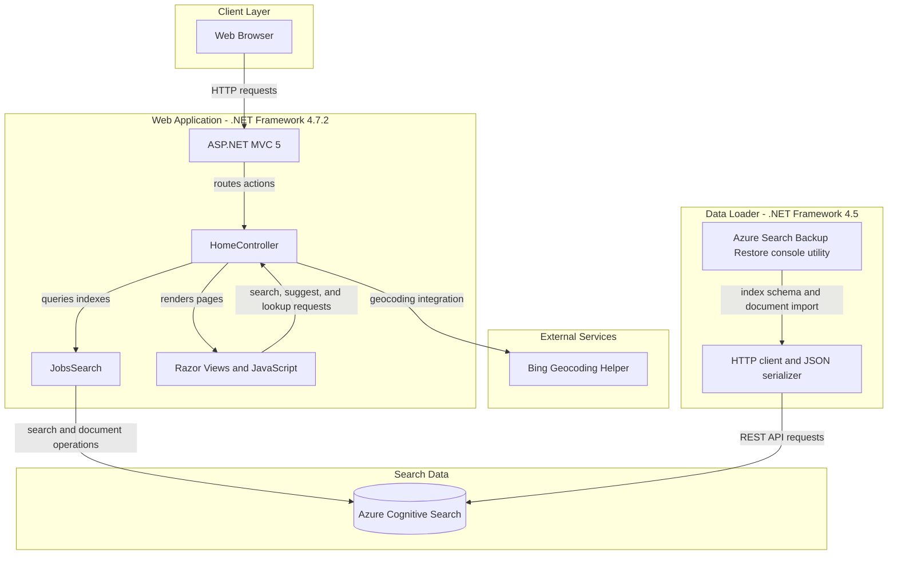
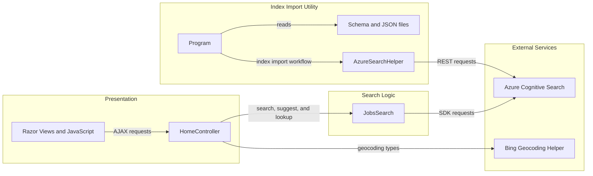

# Architecture Diagram

JobSearch contains an ASP.NET MVC web application for NYC job search and a separate console utility for importing index data into Azure Cognitive Search.

## Application Architecture

### Technology Stack Summary

| Layer | Technology | Version | Purpose |
|---|---|---:|---|
| Presentation | ASP.NET MVC | 5.2.2 | Routes browser requests and renders Razor views |
| Web application runtime | .NET Framework | 4.7.2 | Hosts the MVC web application |
| Search access | Azure.Search.Documents | 11.1.1 | Queries and retrieves Azure Cognitive Search documents |
| Data loader runtime | .NET Framework | 4.5 | Runs the standalone index import utility |
| Data loader HTTP and JSON | System.Net.Http, Newtonsoft.Json | 4.5.2 / 9.0.1 | Calls the Search REST API and processes JSON |
| Browser UI | Razor, JavaScript, jQuery | jQuery 3.1.1 | Displays and interacts with search results |

### Data Storage & External Services

The application uses Azure Cognitive Search indexes named `nycjobs` and `zipcodes` for job postings and ZIP-code geolocation. The web app accesses them through the Azure Search SDK and a Bing geocoding helper dependency. A separate console utility recreates these indexes and uploads schema and JSON data over the Azure Search REST API. No relational database, cache, or message broker is declared in the inspected project configuration.

### Key Architectural Decisions

- The web UI, search controller, and Azure Search integration are organized as an ASP.NET MVC application.
- Index provisioning and sample-data import are handled by a separate console project rather than the web request path.
- Search and location data are held in Azure Cognitive Search indexes rather than an application-managed database.

## Component Relationships

### Component Inventory

| Component | Layer | Type | Responsibility |
|---|---|---|---|
| Razor Views and JavaScript | Presentation | MVC views and browser scripts | Displays search pages and sends browser requests |
| HomeController | Presentation | MVC controller | Serves pages and exposes job search, suggestion, and lookup actions |
| JobsSearch | Search Logic | Search client wrapper | Queries job and ZIP-code indexes and retrieves documents |
| Azure Cognitive Search | External Services | Hosted search service | Stores job and ZIP-code search indexes |
| Bing Geocoding Helper | External Services | SDK dependency | Provides geocoding integration used by the web application |
| Program | Index Import Utility | Console entry point | Coordinates index deletion, creation, and data upload |
| AzureSearchHelper | Index Import Utility | HTTP and JSON helper | Sends REST requests and serializes/deserializes JSON |
| Schema and JSON files | Index Import Utility | Local data files | Define indexes and contain documents for import |
