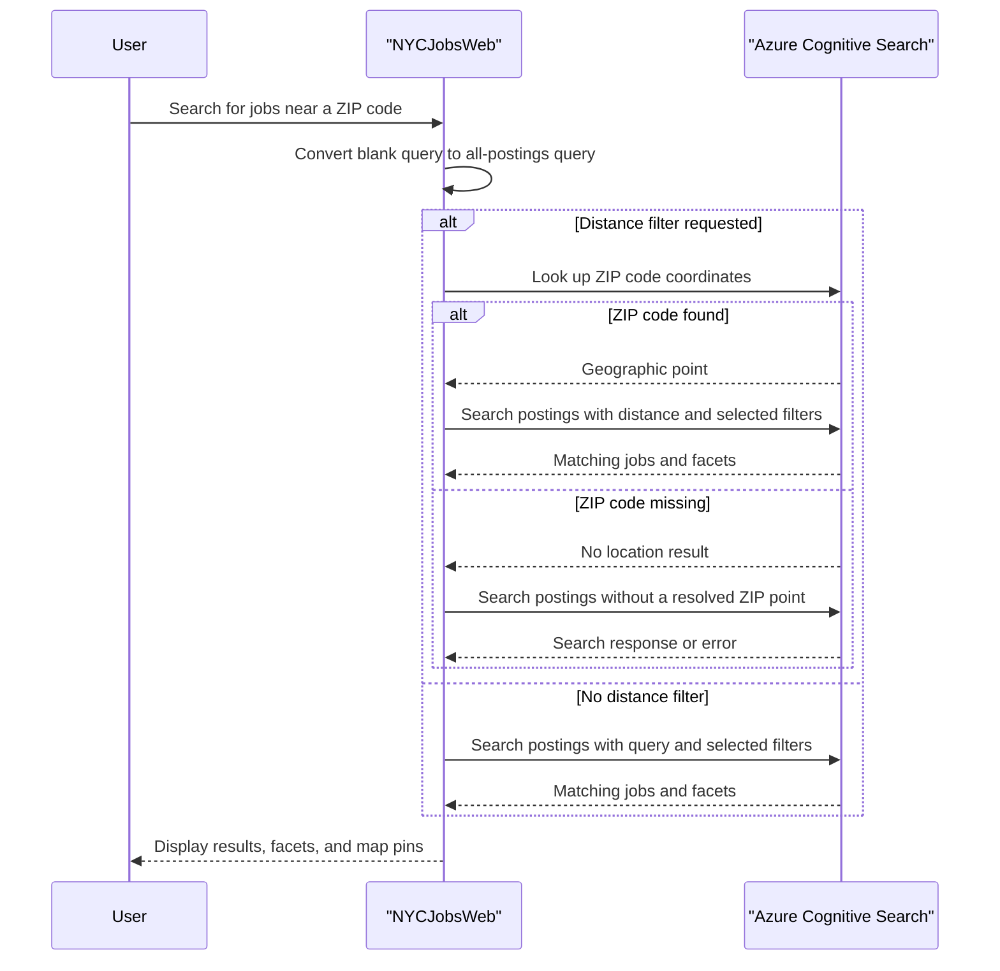

# Core Business Workflows

JobSearch helps users find NYC public-sector job postings by text, location, salary, and posting attributes. A separate utility manages the search indexes and imports sample job and ZIP-code data.

## Domain Entities

| Entity | Service / Bounded Context | Description | Key Relationships |
|---|---|---|---|
| Job Posting | NYCJobsWeb / Job Search | A publicly listed employment opportunity with description, pay, and location information | Associated with a geographic point and can be found through the job search index |
| ZIP Code | NYCJobsWeb / Location Search | A postal area used to look up a geographic center for distance-based searches | Supplies a location used to filter job postings by distance |
| Search Results | NYCJobsWeb / Job Search | A collection of matching job postings, facets, and a result count | Aggregates matching Job Posting documents and available facet values |

## Service-to-Domain Mapping

| Service | Domain Context | Owned Entities | External Dependencies |
|---|---|---|---|
| NYCJobsWeb | Job Search and Location Search | Search Results response; queries Job Posting and ZIP Code indexes | Azure Cognitive Search; Bing geocoding helper |
| AzureSearchBackupRestore | Search Index Administration | Provisions the Job Posting and ZIP Code indexes and imports sample data | Azure Cognitive Search REST API |

The search service is the source of truth for indexed documents. The web application reads search documents; the separate data loader manages index structure and imports data.

## Primary Workflows

### Workflow 1: Search and refine job listings

1. A user opens the listings page, enters a query, and submits a search.
2. A blank query is converted to a wildcard query so all indexed postings can be searched.
3. Optional title, posting type, and salary facets are assembled into a search filter; salary filtering selects the requested range and the next 50,000 increment.
4. The selected sort mode affects result ordering or featured scoring. Paging and map-center coordinates are sent with the search request.
5. The application queries Azure Cognitive Search and returns matching results, facet options, and a count for display and map pins.

### Workflow 2: Search jobs near a ZIP code

1. A user specifies a ZIP code and a positive maximum distance.
2. The application looks up the ZIP code in the ZIP-code index to obtain its geographic point.
3. The coordinates are used in a distance filter on the job-posting index.
4. Matching job results and facets are returned to the listings page.

If the ZIP lookup returns no coordinates, no specific fallback is implemented; downstream search may lack a usable distance point.

### Workflow 3: Load sample search data

1. An operator runs the console utility with the target search service configured.
2. For each of the `zipcodes` and `nycjobs` indexes, the utility deletes the existing index, creates it from the corresponding schema file, and uploads matching JSON document files.
3. The utility reports errors to the console; no transactional rollback or retry flow is defined.

## Cross-Service Data Flows

NYCJobsWeb queries Azure Cognitive Search for job documents, ZIP-code coordinates, and suggestions. ZIP-code data is used to shape a job search request; no service-to-service aggregation between application services was identified. The data loader sends schema and document content to the same search service and is not part of a user request flow. Search failures are caught by the search wrapper and may produce null results; no circuit-breaker or fallback dataset is implemented.

## Business Workflow Sequence

## Business Rules & Decision Logic

- An empty or whitespace-only search term is treated as a wildcard search.
- Search results are limited to ten per request; current page, sort selection, facets, and map coordinates influence the query.
- Salary filters use a 50,000-unit interval from the requested range lower bound.
- A positive maximum distance triggers a ZIP-code lookup and a geographic distance filter.
- Featured sorting applies a scoring profile that considers title relevance, featured tags, posting freshness, and proximity.
- Search and import errors are caught and printed or converted to null results; the application does not define business-level retries, compensation, transaction boundaries, audit trails, or authorization rules.
- No domain validation framework or explicit workflow state transitions were identified.
