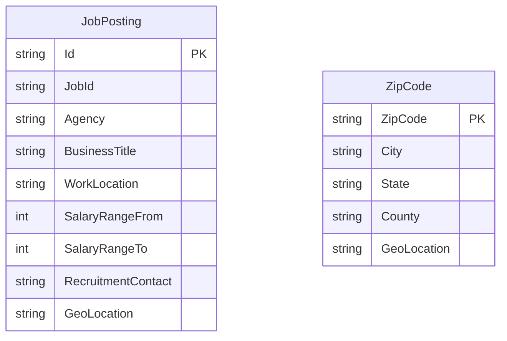

# Data Architecture & Persistence Layer

JobSearch stores job-posting and ZIP-code documents in two Azure Cognitive Search indexes; no relational database or ORM-managed entities were identified. The application also defines response wrapper classes for search results and document lookups.

## Database Configuration

| Service/Module | DB Type | Profile | Driver | Connection | Migration Tool |
|---|---|---|---|---|---|
| NYCJobsWeb | Azure Cognitive Search | No profiles detected | Azure Search .NET SDK | Search endpoint and API key are read from application settings | None detected |
| AzureSearchBackupRestore | Azure Cognitive Search | No profiles detected | HTTP REST API | Target service name and API key are read from application settings | Custom utility creates indexes from schema files and uploads JSON documents |

No SQL database, connection pool, database migration framework, or ORM schema generation was found.

## Data Ownership per Service

| Service | Tables Owned | ORM Framework | Caching | Notes |
|---|---|---|---|---|
| NYCJobsWeb | `nycjobs` and `zipcodes` search indexes (read/query) | None; Azure Search SDK | None identified | Search results are represented by Azure Search SDK types |
| AzureSearchBackupRestore | `nycjobs` and `zipcodes` search indexes (provision/import) | None | None identified | Reads local schema and JSON data files |

## Entity Model

The search indexes are document collections, not relational tables. `NYCJob` and `NYCJobLookup` are API response wrappers; the index schema files define the persistent documents.

No relational relationships, transaction management, or ORM mappings were identified. Index document definitions are in `NYCJobsWeb/Schema_and_Data/nycjobs.schema` and `NYCJobsWeb/Schema_and_Data/zipcodes.schema`; response wrappers are in `NYCJobsWeb/Models/Jobs.cs`.

## Key Repository Methods

| Service | Repository | Notable Methods | Purpose |
|---|---|---|---|
| NYCJobsWeb | `JobsSearch` (`NYCJobsWeb/JobsSearch.cs`) | `Search`, `SearchZip`, `Suggest`, `LookUp` | Queries the job and ZIP-code indexes, retrieves suggestions, and fetches a document by ID |
| AzureSearchBackupRestore | `AzureSearchHelper` (`DataLoader/DataLoader/AzureSearchHelper.cs`) | `SendSearchRequest`, `SerializeJson`, `DeserializeJson` | Sends Search REST API requests and processes JSON |

No repository interfaces or ORM-generated CRUD methods were found.

## Caching Strategy

No application-level caching provider, cache configuration, cache annotations, or cache-aside behavior was identified. Search responses are retrieved from Azure Cognitive Search for each request.

## Data Ownership Boundaries

The web application and import utility access the same two Azure Cognitive Search indexes. The web application queries the indexes through the SDK; the standalone utility provisions the indexes and imports documents through REST. No shared relational database, direct cross-service database access, CQRS implementation, or read/write store split was identified.

### Data Classification & Sensitivity

| Entity | Sensitive Fields | Classification (PII/PHI/PCI/None) | Controls in Place |
|---|---|---|---|
| JobPosting | `recruitment_contact`, `to_apply`, and free-text job fields may include contact information | Potential PII | No application-level encryption-at-rest, masking, or field-level access controls were identified |
| ZipCode | Geographic location and ZIP code | Location data; not necessarily personal data by itself | No application-level encryption-at-rest, masking, or field-level access controls were identified |

The source README describes the included postings as demonstration data and warns that they may not be active or accurate. No PHI or PCI data fields were identified in the index schemas.
