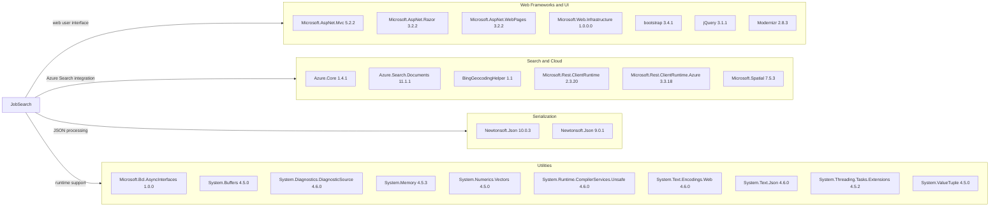

# Dependency Map

JobSearch consists of an ASP.NET MVC web application and a separate Azure Search data-loader utility. The two `packages.config` files declare 25 package entries across the projects (24 for the web application and one for the data loader).

## Dependencies

### Dependency Summary

| Category | Count | Key Libraries | Notes |
|---|---:|---|---|
| Web Frameworks and UI | 7 | ASP.NET MVC 5.2.2, Razor 3.2.2, Bootstrap 3.4.1, jQuery 3.1.1 | Classic ASP.NET MVC and browser UI packages |
| Search and Cloud | 6 | Azure.Search.Documents 11.1.1, Azure.Core 1.4.1, BingGeocodingHelper 1.1 | Search access, Azure support, and geocoding |
| Serialization | 2 | Newtonsoft.Json 10.0.3, Newtonsoft.Json 9.0.1 | Separate package versions in web and data-loader projects |
| Utilities | 10 | System.Text.Json 4.6.0, System.Memory 4.5.3, System.Buffers 4.5.0 | Compatibility and runtime support packages |

### Version & Compatibility Risks

The projects target .NET Framework 4.7.2 and 4.5 and use the legacy `packages.config` dependency model. Several packages and UI libraries are older releases, and the data loader's Newtonsoft.Json 9.0.1 differs from the web project's 10.0.3. Package compatibility and framework support should be reviewed as part of any future migration.

### Notable Observations

- Newtonsoft.Json is declared at different versions in the two projects.
- The web project includes both Newtonsoft.Json and System.Text.Json package references.
- The app uses the Azure Search SDK while the separate loader talks to the service through REST.
- No package-managed test framework or test-scoped dependencies were detected.

## Test Dependencies

| Framework | Version | Notes |
|---|---|---|

Total test-scope dependencies: 0

No test dependencies were detected in the package manifests, and no test project was found.
